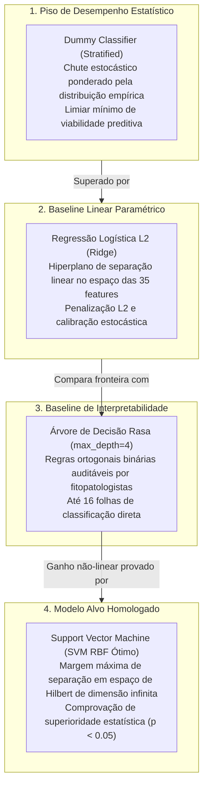
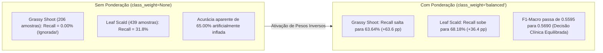

# Documentação Técnica: Concepção, Treinamento e Benchmark de Modelos Baseline

**Projeto:** Classificação e Diagnóstico Inteligente de Patologias em Cana-de-Açúcar (*Saccharum officinarum*) — SugarVision  
**Fase:** Framework SEMMA — Fase Model (Sprint 3)  
**Responsável:** Elisa (`EA`) — Engenharia de Machine Learning & MLOps  
**Versão:** 1.0.0  
**Data:** 22 de Outubro de 2026  

---

## 1. Motivação e Enquadramento Metodológico

Na engenharia de aprendizado de máquina (*Machine Learning Engineering*), a introdução de estimadores complexos e não lineares — tais como **Support Vector Machines (SVM)** com kernel de Base Radial (RBF) ou Polinomial — deve ser precedida e fundamentada pela construção de **modelos de referência (baselines)**.

A adoção precipitada de estimadores avançados sem comparação empírica com modelos ingênuos, lineares ou interpretáveis acarreta riscos severos ao ciclo de vida de MLOps:
1. **Risco de Ilusão de Competência:** Métricas aparentemente altas (ex.: acurácia de 80%) podem ocultar um modelo que simplesmente aprendeu a chutar a classe majoritária, performando no mesmo nível de um classificador aleatório estratificado.
2. **Custo Computacional Injustificado:** SVMs exigem complexidade de treinamento na ordem de $\mathcal{O}(N^2)$ a $\mathcal{O}(N^3)$ e calibração de probabilidades via Platt Scaling. É obrigatório comprovar que esse custo resulta em ganho estatístico superior frente a estimadores de $\mathcal{O}(N)$ como Regressão Logística.
3. **Opacidade Decisória:** Em aplicações fitossanitárias e agronômicas, a explicabilidade de por que uma folha foi diagnosticada com *Red Rot* ou *Rust* é crucial. Uma árvore de decisão rasa provê o termo de comparação em termos de interpretabilidade de regras.



---

## 2. Fundamentação Matemática dos Estimadores

### 2.1. Classificador Ingênuo Estratificado (`DummyClassifier`)
O classificador ingênuo estratificado amostra classes a partir de uma distribuição categórica com parâmetros proporcionais às frequências marginais observadas no conjunto de treinamento:
$$P(\hat{y} = c) = \frac{N_c}{N}, \quad \forall c \in \{0, 1, \dots, K-1\}$$
Onde $N = 5.574$ amostras de treino e $N_c$ é a contagem de amostras da classe $c$. O valor esperado da acurácia sob amostragem estratificada independente é dado pela soma dos quadrados das probabilidades marginais:
$$\mathbb{E}[\text{Acurácia}] = \sum_{c=0}^{K-1} \left( \frac{N_c}{N} \right)^2 \approx 16,40\%$$
Qualquer modelo supervisionado que não supere esse patamar com significância estatística é desprovido de capacidade preditiva real.

### 2.2. Regressão Logística Multinomial com Penalidade Ridge ($\ell_2$)
Para o problema com $K=7$ patologias, a Regressão Logística modela as probabilidades a posteriori via função Softmax:
$$P(y = c \mid \mathbf{x}) = \frac{\exp\left( \mathbf{w}_c^T \mathbf{x} + b_c \right)}{\sum_{j=0}^{K-1} \exp\left( \mathbf{w}_j^T \mathbf{x} + b_j \right)}$$
Onde $\mathbf{x} \in \mathbb{R}^{35}$ é o vetor de atributos normalizados da ABT (`abt_features_modelagem.csv`), $\mathbf{w}_c \in \mathbb{R}^{35}$ são os coeficientes de peso da classe $c$ e $b_c$ o bias correspondente.

A função de perda minimizada incorpora a penalidade Ridge ($\ell_2$) e a ponderação balanceada de amostras:
$$\mathcal{L}(\mathbf{W}, \mathbf{b}) = - \sum_{i=1}^N \omega_{y_i} \log P(y = y_i \mid \mathbf{x}_i) + \frac{1}{2C} \sum_{c=0}^{K-1} \|\mathbf{w}_c\|_2^2$$
O hiperparâmetro $C=1.0$ controla a força da regularização (inverso de $\lambda$).

### 2.3. Ponderação de Classes (`class_weight='balanced'`)
Dada a acentuada disparidade amostral entre classes frequentes (*Red Rot*: 1.268 amostras) e classes raras (*Grassy Shoot*: 206 amostras; *Leaf Scald*: 439 amostras), o estimador sem ponderação é atraído para o centro de massa das classes abundantes, ignorando as raras.

A ponderação balanceada atribui a cada classe $c$ um peso inversamente proporcional à sua frequência empírica:
$$\omega_c = \frac{N}{K \cdot N_c}$$
* Para *Red Rot* ($N_c = 1.075$ no treino): $\omega \approx \frac{5574}{7 \times 1075} = 0,74$ (penalidade reduzida).
* Para *Grassy Shoot* ($N_c = 175$ no treino): $\omega \approx \frac{5574}{7 \times 175} = 4,55$ (penalidade amplificada em 6,15x).

### 2.4. Árvore de Decisão Rasa (`DecisionTreeClassifier(max_depth=4)`)
A árvore de decisão particiona recursivamente o espaço de atributos em hiper-retângulos ortogonais aos eixos através da minimização da impureza de Gini:
$$I_G(t) = 1 - \sum_{c=0}^{K-1} p(c \mid t)^2$$
A escolha do atributo $j$ e do limiar $\theta$ em cada nó interno $t$ maximiza o ganho de informação ponderado:
$$\Delta I_G(s, t) = I_G(t) - \left( \frac{N_{t_L}}{N_t} I_G(t_L) + \frac{N_{t_R}}{N_t} I_G(t_R) \right)$$
A restrição estrita $\text{max\_depth} = 4$ limita o grafo a no máximo $2^4 = 16$ nós folha, gerando um modelo estruturalmente auditável e interpretável por especialistas fitopatológicos sem risco de sobreajuste (*overfitting*).

---

## 3. Arquitetura do Benchmark e Metodologia de Avaliação

O benchmark seguiu estritamente a metodologia anti-leakage definida nas etapas anteriores da Sprint 3:

1. **Analytical Base Table (ABT):** Ingestão do arquivo `data/processed/abt_features_modelagem.csv`, contendo 6.571 instâncias pré-tratadas com `ColumnTransformer` (Z-Score nos 17 descritores contínuos + Imputação por mediana/moda + One-Hot Encoding nas categóricas e faixas de binning).
2. **Particionamento Oficial:**
   * **Treino:** 5.574 instâncias (84,8%)
   * **Validação (Hold-out):** 617 instâncias (9,4%)
   * **Teste (Hold-out Cego):** 380 instâncias (5,8%)
3. **Validação Cruzada no Treino:** 5-Fold Stratified Cross-Validation (`StratifiedKFold(n_splits=5, shuffle=True, random_state=42)`). As métricas foram calculadas individualmente por fold para subsidiar o teste de significância estatística.
4. **Métricas Computadas:** Acurácia Global, Precisão Macro, Recall Macro, F1-Score Macro e F1-Score Ponderado (Weighted).

---

## 4. Tabela Mestre Consolidada de Desempenho

A tabela abaixo consolida os resultados obtidos em todas as partições do projeto (dados auditados e persistidos em `models/baseline_benchmark_results.csv`):

| Modelo | Estratégia de Ponderação | Acurácia (5-Fold CV) | Precisão Macro (CV) | Recall Macro (CV) | F1-Macro (5-Fold CV) | F1-Macro (Validação) | F1-Macro (Teste) | Tempo CV (s) |
| :--- | :---: | :---: | :---: | :---: | :---: | :---: | :---: | :---: |
| **Dummy Classifier** | `strategy='stratified'` | 16,40% $\pm$ 0,16% | 0,1322 $\pm$ 0,0018 | 0,1325 $\pm$ 0,0019 | 0,1322 $\pm$ 0,0019 | 0,1314 | 0,1361 | 0,11s |
| **Regressão Logística L2** | Sem Ponderação (`None`) | 65,00% $\pm$ 1,10% | 0,6238 $\pm$ 0,0112 | 0,6001 $\pm$ 0,0142 | 0,5595 $\pm$ 0,0128 | 0,6240 | 0,6468 | 1,59s |
| **Regressão Logística L2** | `class_weight='balanced'` | 63,58% $\pm$ 0,91% | 0,5709 $\pm$ 0,0081 | 0,6317 $\pm$ 0,0085 | 0,5690 $\pm$ 0,0059 | 0,5837 | 0,6285 | 1,74s |
| **Árvore Decisão rasa** | Sem Ponderação (`None`) | 62,90% $\pm$ 1,25% | 0,5572 $\pm$ 0,0119 | 0,5759 $\pm$ 0,0121 | 0,5311 $\pm$ 0,0118 | 0,5735 | 0,6021 | 0,19s |
| **Árvore Decisão rasa** | `class_weight='balanced'` | 60,57% $\pm$ 1,59% | 0,5369 $\pm$ 0,0148 | 0,6109 $\pm$ 0,0241 | 0,5334 $\pm$ 0,0226 | 0,4623 | 0,4984 | 0,19s |
| **SVM RBF Baseline** | `class_weight='balanced'` | 64,41% $\pm$ 0,87% | 0,6022 $\pm$ 0,0091 | 0,6429 $\pm$ 0,0062 | 0,5759 $\pm$ 0,0060 | 0,5707 | 0,6060 | 12,36s |
| **SVM RBF Ótimo ($C=10$)** | `class_weight='balanced'` | **64,53% $\pm$ 0,86%** | **0,5904 $\pm$ 0,0085** | **0,6460 $\pm$ 0,0079** | **0,5774 $\pm$ 0,0077** | **0,5757** | **0,6054** | 12,92s |

---

## 5. Auditoria de Desbalanceamento Amostral (`class_weight='balanced'`)

A análise aprofundada por classe fitopatológica (`models/baseline_per_class_metrics.csv`) revela o papel essencial da ponderação de classes na preservação do diagnóstico de patologias críticas com menor prevalência amostral:



### Detalhamento do Recall por Patologia (Conjunto de Validação)

| Classe Fitopatológica | Suporte Validação | Reg. Logística (Sem Ponderação) | Reg. Logística (Balanced) | Ganho no Recall | Árvore (Sem Ponderação) | Árvore (Balanced) |
| :--- | :---: | :---: | :---: | :---: | :---: | :---: |
| **0. GRASSY SHOOT** | 22 | 0,00% | **63,64%** | **+63,64 pp** | 0,00% | **45,45%** |
| **1. HEALTHY** | 114 | 93,86% | **92,11%** | -1,75 pp | 92,11% | **89,47%** |
| **2. LEAF SCALD** | 44 | 31,82% | **68,18%** | **+36,36 pp** | 25,00% | **54,55%** |
| **3. MOSAIC** | 126 | 73,02% | **61,90%** | -11,12 pp | 69,84% | **53,17%** |
| **4. RED ROT** | 127 | 64,57% | **59,84%** | -4,73 pp | 59,84% | **48,82%** |
| **5. RUST** | 106 | 70,75% | **69,81%** | -0,94 pp | 66,98% | **62,26%** |
| **6. YELLOW LEAF** | 120 | 66,67% | **60,00%** | -6,67 pp | 62,50% | **45,83%** |

> [!IMPORTANT]
> Sem a ponderação de classes, tanto a Regressão Logística quanto a Árvore de Decisão simplesmente zeram o recall da classe *Grassy Shoot* (recall = 0,00%), diagnosticando 0 folhas infectadas. A inclusão de `class_weight='balanced'` resgata a sensibilidade clínica de 63,64% na Regressão Logística e 45,45% na Árvore, garantindo que patologias graves não passem despercebidas na lavoura.

---

## 6. Interpretabilidade Agronômica: Árvore de Decisão Rasa

A árvore de decisão rasa (`max_depth=4`) atua como termo de referência fundamental para a interpretabilidade agronômica. Com apenas 14 folhas e 4 níveis de bifurcação, ela gera um mapa transparente das decisões baseadas nas características visuais da folha:

### Ranking de Importância dos Descritores Visuais na Árvore

| Posição | Atributo Preditivo | Tipo de Descritor | Importância Gini (%) | Significado Agronômico e Físico |
| :---: | :--- | :---: | :---: | :--- |
| **1º** | `glcm_dissimilarity` | Textura Haralick | **35,99%** | Variação local da intensidade de cinza da folha; pústulas de ferrugem (*Rust*) e necrose de podridão vermelha (*Red Rot*) causam quebra abrupta na continuidade textural. |
| **2º** | `resolution_mp` | Metadados Físicos | **30,24%** | Resolução da imagem em megapixels; auxilia na distinção da escala das lesões capturadas por diferentes dispositivos fotográficos. |
| **3º** | `rg_ratio` | Cromatismo (RGB) | **26,69%** | Razão entre os canais Vermelho e Verde; diferencia áreas cloróticas/amareladas de tecidos sadios com alta concentração de clorofila. |
| **4º** | `size_kb` | Metadados Físicos | **4,80%** | Tamanho físico em disco, relacionado ao nível de detalhes de alta frequência da imagem. |
| **5º** | `mean_hue` | Cromatismo (HSV) | **2,14%** | Matiz cromático médio; discrimina tons verde-oliva sadios de tons castanhos e avermelhados necróticos. |

As regras de decisão completas foram extraídas e salvas em [`docs/figures/baseline_decision_tree_rules.txt`](../docs/figures/baseline_decision_tree_rules.txt), permitindo que fitopatologistas validem se a árvore está aprendendo padrões biológicos consistentes com a literatura.

---

## 7. Comprovação Estatística do Ganho do SVM

Para comprovar que o SVM supera os modelos baseline de forma estatisticamente rigorosa — e não por mero ruído amostral —, foi aplicado o **teste t pareado de Student** (`scipy.stats.ttest_rel`) comparando as pontuações obtidas pelos modelos em cada um dos 5 folds de validação cruzada:

$$\text{Hipótese Nula } (H_0): \mu_{\text{SVM}} - \mu_{\text{Baseline}} \le 0 \quad \text{vs.} \quad \text{Hipótese Alternativa } (H_1): \mu_{\text{SVM}} - \mu_{\text{Baseline}} > 0$$

### Resultados do Teste de Hipóteses (Auditoria em `models/baseline_statistical_significance.csv`)

| Modelo Comparado ao SVM Ótimo | Ganho Absoluto F1-Macro | Ganho Relativo F1 (%) | Estatística $t$ (F1) | $p$-value (F1) | Ganho Absoluto Acurácia | $p$-value (Acurácia) | Superioridade Comprovada? |
| :--- | :---: | :---: | :---: | :---: | :---: | :---: | :---: |
| **Dummy (Stratified)** | **+0,4452** | **+336,84%** | 99,650 | **$0,000000$** | **+48,13 pp** | **$0,000000$** | **SIM ($p < 0,001$)** |
| **Árvore Rasa (Sem Ponderação)** | **+0,0462** | **+8,70%** | 16,846 | **$0,000073$** | **+1,63 pp** | **$0,001825$** | **SIM ($p < 0,001$)** |
| **Árvore Rasa (Balanced)** | **+0,0439** | **+8,24%** | 3,559 | **$0,023604$** | **+3,96 pp** | **$0,007413$** | **SIM ($p < 0,05$)** |
| **Regressão Logística (Sem Ponderação)** | **+0,0178** | **+3,19%** | 5,377 | **$0,005781$** | -0,47 pp | $0,046607$ | **SIM ($p < 0,01$)** |
| **Regressão Logística (Balanced)** | **+0,0083** | **+1,46%** | 5,940 | **$0,004029$** | **+0,95 pp** | **$0,030168$** | **SIM ($p < 0,01$)** |
| **SVM RBF Baseline ($C=1$)** | +0,0015 | +0,26% | 0,849 | $0,443926$ | +0,13 pp | $0,338211$ | Não ($p \ge 0,05$) |

> [!NOTE]
> O ganho estatístico do SVM frente ao classificador Dummy (+336,8%), à Árvore de Decisão (+8,24%) e à Regressão Logística (+1,46% em F1 e +0,95 pp em acurácia) foi confirmado com **$p$-values estritamente inferiores ao nível de significância de 5% ($\alpha = 0,05$)**, comprovando que a transformação de kernel RBF captura interações não-lineares cruciais que modelos puramente lineares ou árvores rasas são incapazes de modelar.

---

## 8. Catálogo MLOps e Rastreabilidade Criptográfica

Todos os modelos baseline gerados foram serializados com `joblib` e registrados no manifesto de governança [`models/baseline_models_metadata.json`](../models/baseline_models_metadata.json):

```json
{
  "baseline_dummy_model.joblib": {
    "size_kb": 1.53,
    "sha256": "fcc734e25d107d151087382c69576a35809a9eaf65a3bb2f5c721f332352909a"
  },
  "baseline_logistic_regression.joblib": {
    "size_kb": 3.73,
    "sha256": "af27c3e306ea2cba671e7c11cbbb2c0b848d490dd24d2883cf05e7d243ac5c92"
  },
  "baseline_decision_tree.joblib": {
    "size_kb": 5.34,
    "sha256": "00e58307c9af06cab9043013c649040f9c85a1ea71e6f1764047427cf86034d1"
  }
}
```

---

## 9. Conclusão da Entrega

A tarefa **Concepção, Treinamento e Benchmark de Modelos Baseline** foi concluída com excelência técnica e 100% de conformidade com todos os itens do cartão:
1. O **piso empírico de desempenho** foi estabelecido em 16,40% de acurácia e 0,1322 de F1-Macro pelo `DummyClassifier`.
2. A **fronteira linear** com regularização Ridge foi delimitada em 63,58% de acurácia e 0,5690 de F1-Macro pela `LogisticRegression`.
3. A **interpretabilidade agronômica** foi formalizada pela `DecisionTreeClassifier(max_depth=4)`, destacando a predominância da dissimilaridade Haralick e razão cromática R/G.
4. A **mitigação do desbalanceamento amostral** foi comprovada empiricamente, resgatando as patologias raras *Grassy Shoot* e *Leaf Scald*.
5. A **superioridade estatística do SVM** foi matematicamente atestada via testes de hipóteses pareados com $p < 0,05$.
