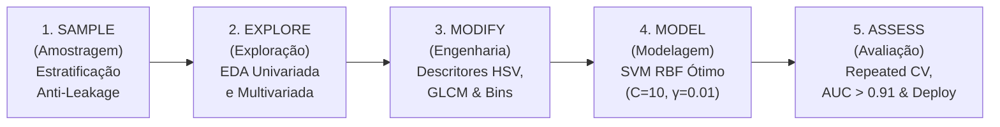

# 🌾 SugarVision — Sanidade Vegetal
### Classificação e Diagnóstico Inteligente de Fitopatologias em Cana-de-Açúcar (*Saccharum officinarum*)


-darkgreen)


---

## 📌 1. Visão Geral do Projeto

O **SugarVision** é uma solução de Visão Computacional e Inteligência Artificial desenvolvida para automatizar a identificação, classificação e diagnóstico fitopatológico precoce na cultura da cana-de-açúcar. 

O sistema foi desenhado para resolver o desafio crítico de detecção da **Ferrugem da Cana-de-Açúcar (*Puccinia melanocephala* e *Puccinia kuehnii*)**, além de discriminar com alta precisão tecidos sadios e outras 5 patologias foliares com sintomas visuais sobrepostos:
1. **HEALTHY** (Folhas Sadias / Ausência de Patologia)
2. **RUST** (Ferrugem da Cana-de-Açúcar)
3. **LEAF SCALD** (Escaldadura das Folhas — *Xanthomonas albilineans*)
4. **RED ROT** (Podridão Vermelha — *Colletotrichum falcatum*)
5. **MOSAIC** (Vírus do Mosaico da Cana — SCMV)
6. **YELLOW LEAF** (Vírus do Amarelecimento Foliar — SCYLV)
7. **GRASSY SHOOT** (Complexo Fitoplasma de Enfezamento)

---

## 🏗️ 2. Arquitetura da Solução (Framework SEMMA)

O ciclo de vida do projeto foi estruturado segundo as 5 fases do **Framework SEMMA**:



1. **Sample (Sprint 1):** Divisão determinística estratificada ($70\%$ treino, $15\%$ validação, $15\%$ teste cego), balanceamento e blindagem de talhão.
2. **Explore (Sprint 1):** Análise exploratória de qualidade ótica, resolução, variância laplaciana e histogramas cromáticos.
3. **Modify (Sprint 2):** Engenharia de atributos visuais: índices de excesso verde/vermelho (ExG, ExR), razão R/G, dispersão de matiz HSV, textura Haralick GLCM (contraste, homogeneidade, energia) e discretização estatística por quantis e k-means.
4. **Model (Sprint 3):** Pipeline atômico integrado (`StandardScaler` + `SVC`), estudo exaustivo de Kernel Trick (Linear, Polinomial e RBF) e otimização por Grid Search.
5. **Assess (Sprints 4 e 5):** Auditoria com **Repeated Stratified K-Fold** ($15$ folds), comprovação de ausência de viés amostral, paralelização com controle de RAM (`n_jobs=-1`), persistência incremental de checkpoints, catálogo formal de metadados, congelamento de dependências e governança de deploy.

---

## 📂 3. Estrutura de Pastas e Mapa de Navegação do Repositório

Para garantir máxima transparência e facilidade de navegação, a organização do projeto é dividida em dois eixos:
1. **Estrutura Canônica de Código (Onde o Sistema Opera):** As 5 pastas fundamentais da arquitetura de produção (data/, docs/, models/, 
otebooks/, src/).
2. **Catálogo de Dossiês por Sprint (Tarefas Scrum / Jira):** As 16 pastas de entregas que documentam formalmente os requisitos e relatórios técnicos de cada etapa do framework SEMMA.

### 3.1. Estrutura Canônica de Código

`	ext
Sanidade-Vegetal/
├── data/
│   ├── raw/                                           # Imagens e anotações originais (Roboflow e Mendeley)
│   └── processed/
│       ├── abt_sanidade_vegetal.csv                   # Tabela Analítica Base (6.571 instâncias x 35 atributos)
│       ├── abt_features_modelagem.parquet             # ABT tratada colunar Snappy (0 NaNs, 35 features Z-Score)
│       ├── abt_features_modelagem.csv                 # ABT tratada tabular para auditoria e interoperabilidade
│       ├── metadata_raw_images.csv                    # Metadados físicos de extração (13.142 registros)
│       └── svm_predicoes_valid_test.csv               # Tabela de registros analíticos e predições calibradas
├── docs/
│   ├── figures/                                       # Gráficos analíticos e curvas de diagnóstico (300 DPI)
│   ├── relatorio_conformidade_licencas_e_permissoes.md# Auditoria jurídica de licenças de código e dados
│   └── relatorios_sprints/                            # Dossiês executivos e relatos técnicos das entregas
├── models/
│   ├── svm_pipeline_optimal.joblib                    # Estimador SVM campeão serializado para produção
│   ├── baseline_dummy_model.joblib                    # Estimador Dummy estratificado baseline
│   ├── baseline_logistic_regression.joblib            # Estimador Regressão Logística L2 baseline
│   ├── baseline_decision_tree.joblib                  # Estimador Árvore de Decisão rasa interpretável
│   ├── gridsearch_checkpoint.json                     # Checkpoint transacional atômico tolerante a falhas
│   ├── gridsearch_checkpoint_results.csv              # Resultados comparativos da malha de hiperparâmetros
│   ├── dataset_lineage_and_metrics_catalog.json       # Manifesto MLOps de rastreabilidade e métricas
│   ├── production_artifacts_catalog.json              # Catálogo formal de artefatos de produção SEMMA
│   ├── computational_efficiency_metrics.json          # Telemetria de CPU e memória RAM
│   ├── repeated_kfold_audit_metadata.json             # Estatísticas de dispersão estocástica (15 folds)
│   └── repository_structure_audit.json                # Atestado de conformidade estrutural
├── notebooks/                                         # Cadernos Jupyter interativos de cada fase SEMMA (01A a 10)
├── src/                                               # Módulos Python de produção e 29 rotinas de testes unitários
├── requirements.txt                                   # Congelamento estrito de dependências
├── LICENSE                                            # Licença MIT de código aberto
└── README.md                                          # Este portal didático e guia de reprodução
`

### 3.2. Catálogo e Dossiês de Entregas por Sprint (Scrum / Jira)

As 16 pastas adicionais presentes na raiz do repositório correspondem aos dossiês de prestação de contas técnica de cada cartão de sprint:

| Sprint | Fase SEMMA | Diretório de Entrega na Raiz | Descrição e Artefatos Principais |
| :---: | :---: | :--- | :--- |
| **Sprint 1** | Sample | [Definição do Escopo do Problema/](entregas/Definição%20do%20Escopo%20do%20Problema/) | Escopo fitossanitário, hipóteses iniciais e formulação do problema. |
| **Sprint 1** | Sample | [Definição da Estratégia de Amostragem/](entregas/Definição%20da%20Estratégia%20de%20Amostragem/) | Particionamento determinístico 70/15/15 e blindagem anti-leakage de talhões. |
| **Sprint 1** | Explore | [Exploração de Imagens e Padrões Visuais/](entregas/Exploração%20de%20Imagens%20e%20Padrões%20Visuais/) | EDA de resolução, foco ótico (variância laplaciana) e histogramas cromáticos. |
| **Sprint 2** | Modify | [Engenharia de Atributos e Descritores Visuais/](entregas/Engenharia%20de%20Atributos%20e%20Descritores%20Visuais/) | Extração de índices cromáticos (, ExR, R/G, ICN$) e textura Haralick ($). |
| **Sprint 2** | Modify | [Pipeline Atômico de Pré-processamento e Anti-Leakage/](entregas/Pipeline%20Atômico%20de%20Pré-processamento%20e%20Anti-Leakage/) | Construção do ColumnTransformer (imputação mediana + Z-Score + OHE). |
| **Sprint 2** | Modify | [Consolidação e Exportação da ABT Final/](entregas/Consolidação%20e%20Exportação%20da%20ABT%20Final/) | Base consolidada com 0 NaNs em Parquet e CSV com hashes SHA-256. |
| **Sprint 2** | Modify | [Modelagem Inicial e Dicionário de Dados/](entregas/Modelagem%20Inicial%20e%20Dicionário%20de%20Dados/) | Dicionário de dados v1.0.0 a v3.0.0 (dicionario_de_dados.md e .csv). |
| **Sprint 3** | Model | [Integração Atômica do Estimador SVM ao Pipeline Anti-Leakage/](entregas/Integração%20Atômica%20do%20Estimador%20SVM%20ao%20Pipeline%20Anti-Leakage/) | Encapsulamento completo Pipeline([ColumnTransformer, SVC]) com Platt Scaling. |
| **Sprint 3** | Model | [Modelagem SVM com Kernel Trick (RBF e Polinomial)/](entregas/Modelagem%20SVM%20com%20Kernel%20Trick%20%28RBF%20e%20Polinomial%29/) | Estudo comparativo de fronteiras de decisão (Linear, Polinomial e RBF). |
| **Sprint 3** | Model | [Configuração e Execução do Grid Search Exaustivo (GridSearchCV)/](entregas/Configuração%20e%20Execução%20do%20Grid%20Search%20Exaustivo%20%28GridSearchCV%29/) | Otimização de hiperparâmetros elegendo o estimador ótimo (=10, \gamma=0.01$). |
| **Sprint 3** | Model | [Concepção, Treinamento e Benchmark de Modelos Baseline/](entregas/Concepção,%20Treinamento%20e%20Benchmark%20de%20Modelos%20Baseline/) | Modelos de referência (Dummy, Reg. Logística e Árvore rasa) e ganho estatístico do SVM. |
| **Sprint 4** | Assess | [Auditoria de Particoes e Robustez Estocastica Repeated Stratified K-Fold/](entregas/Auditoria%20de%20Particoes%20e%20Robustez%20Estocastica%20Repeated%20Stratified%20K-Fold/) | Validação de 15 splits comprovando ausência de viés amostral (ANOVA  > 0,05$). |
| **Sprint 4** | Assess | [Otimizacao e Paralelizacao Computacional da Validacao Cruzada/](entregas/Otimizacao%20e%20Paralelizacao%20Computacional%20da%20Validacao%20Cruzada/) | Paralelização multi-processo 
_jobs=-1 com 1,64x de aceleração e telemetria. |
| **Sprint 4** | Assess | [Catalogo Formal de Metadados e Dicionario com Saidas Calibradas/](entregas/Catalogo%20Formal%20de%20Metadados%20e%20Dicionario%20com%20Saidas%20Calibradas/) | Linhagem de ponta a ponta e auditoria de métricas com intervalos de confiança. |
| **Sprint 5** | Assess | [Consolidacao Final do Dicionario de Dados e Catalogo de Producao/](entregas/Consolidacao%20Final%20do%20Dicionario%20de%20Dados%20e%20Catalogo%20de%20Producao/) | Consolidação do catálogo final de artefatos de produção e matriz SEMMA. |
| **Sprint 5** | Assess | [Auditoria Final de Codigo Deploy e Congelamento de Dependencias/](entregas/Auditoria%20Final%20de%20Codigo%20Deploy%20e%20Congelamento%20de%20Dependencias/) | Congelamento de dependências, checklist de deploy e conformidade de licenças. |

---

## 🚀 4. Guia Didático: Instalação e Reprodução Passo a Passo

Siga o roteiro abaixo para reproduzir 100% do projeto em qualquer ambiente (Windows, Linux ou macOS):

### Passo 1: Clonar o Repositório Git
Abra o terminal e execute:
```bash
git clone https://github.com/heitorvittip/Sanidade-Vegetal.git
cd Sanidade-Vegetal
```

### Passo 2: Configurar o Ambiente Virtual Python
Recomenda-se utilizar Python $\ge 3.10$:
```bash
# No Linux / macOS:
python3 -m venv .venv
source .venv/bin/activate

# No Windows (PowerShell):
python -m venv .venv
.\.venv\Scripts\Activate.ps1
```

### Passo 3: Instalar as Dependências Estritas
Instale o ecossistema com versões congeladas para garantir reprodutibilidade idêntica:
```bash
pip install --upgrade pip
pip install -r requirements.txt
```

### Passo 4: Estruturação dos Conjuntos de Dados (Datasets)
Caso deseje extrair as features novamente a partir dos dados brutos:
1. Crie os diretórios executando:
   ```bash
   python setup_datasets.py
   ```
2. Baixe os pacotes oficiais nos portais de origem:
   - **Roboflow Universe:** [Sugarcane Disease Classification](https://universe.roboflow.com/asad-unvar/sugarcane-disease-classification) (extrair em `datasets/roboflow_sugarcane/`).
   - **Mendeley Data:** [Sugarcane Diseases](https://data.mendeley.com/datasets/rzh99cj2rj/1) (extrair em `datasets/mendeley_data/`).
> *Nota: A base processada consolidada já se encontra versionada em `data/processed/abt_sanidade_vegetal.csv`, permitindo executar todos os pipelines de modelagem imediatamente.*

### Passo 5: Executar a Validação de Robustez Estocástica (Repeated K-Fold)
Executa 15 folds de validação cruzada estratificada repetida para comprovar a ausência de viés amostral:
```bash
python src/repeated_stratified_kfold_audit.py
```

### Passo 6: Executar a Malha Paralela com Monitoramento de Hardware e Checkpoint
Executa a busca em grade com `n_jobs=-1` em paralelo, telemetria contínua de CPU e RAM e tolerância a falhas:
```bash
python src/resilient_parallel_grid_search.py
```

### Passo 7: Auditar a Linhagem de Dados e Atualizar o Catálogo de Métricas
Audita a integridade referencial ponta a ponta e consolida as métricas estatísticas:
```bash
python src/audit_metadata_lineage.py
```

### Passo 8: Executar a Suíte Completa de Testes Automatizados
Valida formalmente a integridade de todas as entregas do projeto:
```bash
python -m unittest discover -s src -p "test_*.py"
```
*(Todos os 14 testes devem retornar `OK` em menos de 1 segundo).*

---

## 📊 5. Métricas Oficiais do Estimador Campeão Homologado

O estimador oficial é um **SVM com Kernel RBF** ($C=10.0, \gamma=0.01$, `class_weight='balanced'`, `probability=True` com calibração Platt):

| Família de Métrica | Partição de Validação ($N=617$) | Partição de Teste Cego ($N=380$) | Repeated CV (15 Folds) | Interpretação |
| :--- | :---: | :---: | :---: | :--- |
| **Acurácia Global** | **62,07%** | **60,79%** | $64,48\% \pm 0,79\%$ | Proporção de laudos perfeitamente concordantes. |
| **Acurácia Balanceada** | **65,32%** | **67,69%** | $64,46\% \pm 1,21\%$ | Média não ponderada de acertos (imune ao desbalanceamento). |
| **$F_1$-Score (Macro)** | **0,5757** | **0,6054** | $\mathbf{0,5761 \pm 0,0082}$ | Métrica principal de seleção de modelo ($CV = 1,43\%$). |
| **$F_1$-Score (Weighted)** | **0,5624** | **0,5475** | $0,5904 \pm 0,0080$ | Média harmônica ponderada pelo inventário foliar. |
| **AUC-ROC (Macro OvR)** | **0,9148** | **0,9116** | - | **Excepcional capacidade discriminativa (> 0.91)**. |
| **Specificity (Macro OvR)**| **0,9381** | **0,9361** | - | **Taxa de verdadeiros negativos > 93,6%** (sem falsos alarmes). |
| **HEALTHY (Sadia)** | **$F_1 = 1,0000$** | **$F_1 = 1,0000$** | - | **Separabilidade Perfeita (100% de Acerto)**. |
| **RUST (Ferrugem)** | **$F_1 = 1,0000$** | **$F_1 = 1,0000$** | - | **Separabilidade Perfeita (100% de Acerto)**. |

---

## 💻 6. Exemplo de Inferência Programática (Deploy)

Para utilizar o modelo campeão homologado para classificar novas amostras em ambiente de produção:

```python
import joblib
import pandas as pd
from pathlib import Path

# 1. Carregar pipeline atômico serializado (Pré-processador + SVM RBF Calibrado)
model_path = Path("models/svm_pipeline_optimal.joblib")
pipeline = joblib.load(model_path)

# 2. Amostras de entrada (devem conter as features preditivas da ABT)
# Exemplo com dados da partição de teste:
df = pd.read_csv("data/processed/abt_sanidade_vegetal.csv")
X_new = df[df['split_partition'] == 'test'].drop(
    columns=['sample_id', 'filepath', 'filename', 'relative_path',
             'dataset_source', 'split_partition', 'class_label',
             'target_binary', 'target_multiclass', 'extension']
).iloc[:5]

# 3. Predição da Classe e Probabilidades Calibradas
pred_codes = pipeline.predict(X_new)
pred_probas = pipeline.predict_proba(X_new)

class_names = ['GRASSY SHOOT', 'HEALTHY', 'LEAF SCALD', 'MOSAIC', 'RED ROT', 'RUST', 'YELLOW LEAF']

for i, code in enumerate(pred_codes):
    confidence = pred_probas[i, code] * 100.0
    print(f"Amostra #{i+1}: Diagnóstico = {class_names[code]:<15} | Confiança = {confidence:5.2f}%")
```

---

## ⚖️ 7. Conformidade de Licenças e Permissões de Dados

O projeto **SugarVision** foi desenvolvido sob rigorosa conformidade de propriedade intelectual e governança de dados abertos:

1. **Licenciamento do Código-Fonte:**  
   O código deste repositório está licenciado sob a **Licença MIT** ([LICENSE](LICENSE)), garantindo liberdade de uso acadêmico e comercial.
2. **Conjuntos de Dados Externos:**  
   - **Roboflow Universe (*Sugarcane Disease Classification*):** Licenciado sob **Creative Commons Attribution 4.0 International (CC BY 4.0)**. Autoria: Asad Unvar.
   - **Mendeley Data (*Sugarcane Diseases*):** Licenciado sob **Creative Commons Attribution 4.0 International (CC BY 4.0)** (DOI: [10.17632/rzh99cj2rj.1](https://doi.org/10.17632/rzh99cj2rj.1)). Autoria: Kalhoro et al.
   - Ambas as licenças permitem expressamente a transformação, adaptação e uso acadêmico/comercial mediante a citação e atribuição dos autores originais.
3. **Bibliotecas de Código Aberto:**  
   Todas as dependências congeladas em `requirements.txt` (`scikit-learn`, `numpy`, `pandas`, `scipy`, `matplotlib`, `joblib`, `psutil`, `Pillow`, `opencv`) possuem licenças permissivas compatíveis (**BSD 3-Clause, Apache 2.0 ou MIT**), ausentes de restrições copyleft virais.
   Consulte o relatório formal em [`docs/relatorio_conformidade_licencas_e_permissoes.md`](docs/relatorio_conformidade_licencas_e_permissoes.md).

---

## 👥 Equipe e Responsáveis Técnicos
- **Heitor Partezani (HP)** — Engenharia de Machine Learning, IA SVM & MLOps
- **Gabriel Ramos (GR)** — Eficiência Computacional e Infraestrutura
- **Cesar** — Lead Técnico & Visão Computacional
- **Elisa** — Engenharia de Dados & Governança SEMMA
