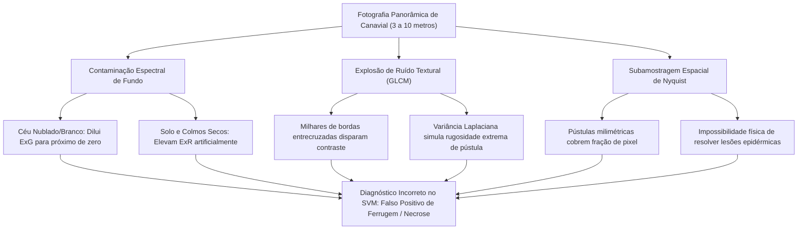

# 🌿 Nota Técnica: Especificidade de Escala, Domínio Operacional e Limitações Físico-Matemáticas do Classificador SugarVision

**Projeto:** SugarVision — Sanidade Vegetal (*Saccharum officinarum* / Fitopatologia de Precisão)  
**Sprint:** 5 — Framework SEMMA (Fase: Assess & Deploy Readiness — Demoday 5)  
**Responsável Técnico:** Cesar (Lead Técnico & Visão Computacional)  
**Detentores dos Direitos Autorais (Copyright © 2026):**  
Heitor Vitti, César Bovo, Guilherme Romanzotti, Marvin Cristhian, Elisa Alcantara e Luis Otávio.

---

## 1. Sumário Executivo e Declaração de Escopo

O classificador **SugarVision** foi concebido, arquitetado, treinado e homologado especificamente para atuar no nível de **Inspeção Foliar Direcionada (*Leaf-Level Macro Inspection*)**. Isso significa que o modelo recebe e processa **recortes em *close-up* de lâminas foliares individuais**, onde a superfície vegetal ocupa a quase totalidade do enquadramento fotográfico (entre 80% e 100% da área útil da imagem).

```
+-------------------------------------------------------------------------------------------------------+
|                                    DELIMITAÇÃO DO ESCOPO OPERACIONAL                                  |
+-------------------------------------------------------------------------------------------------------+
| [DOMÍNIO HOMOLOGADO]      -> Macrofotografia aproximada da lâmina foliar (10 cm a 30 cm de distância).|
|                              Objetivo: Diagnosticar micro-lesões, pústulas e cloroses na epiderme.    |
|                                                                                                       |
| [DOMÍNIO NÃO SUPORTADO]   -> Fotografia panorâmica de paisagem / talhão / dossel (3 m a 10 m).         |
|                              Limitação: Presença de céu, solo exposto, colmos secos e sobreposição.   |
+-------------------------------------------------------------------------------------------------------+
```

Quando submetido a uma fotografia panorâmica de um canavial inteiro (composta por céu, solo, plantas inteiras a metros de distância e palhada seca), o pipeline **não consegue atestar a sanidade das plantas**, incorrendo em diagnósticos distorcidos de falsa severidade ou anomalia. 

Esta nota técnica documenta formalmente os fundamentos físico-ópticos, matemáticos e amostrais que explicam essa especificidade de escala e delimitam as condições de contorno do sistema.

---

## 2. Por que o modelo falha em fotos panorâmicas de plantação?

A falha do classificador diante de tomadas abertas de campo decorre de três rupturas analíticas simultâneas:



---

### 2.1 Contaminação dos Tensores Bio-Espectrais Globais ($ExG$ e $ExR$)

O extrator de atributos calcula os índices de vegetação e a crominância como médias espaciais sobre a matriz $640 \times 640$ normalizada da imagem:

$$\text{ExG} = 2G - R - B$$
$$\text{ExR} = 1.4R - G$$

Em uma fotografia foliar adequada (close-up de folha sadia):
* A folha sadia absorve fortemente no azul ($B \approx 30\text{--}50$) e no vermelho ($R \approx 40\text{--}60$), com pico de reflectância no verde pela clorofila ($G \approx 130\text{--}160$).
* Resultado característico de folha sadia: $\text{ExG} \in [38, 55]$ e $\text{ExR} \in [-25, -10]$.

Em uma foto panorâmica de plantação:
1. **Impacto do Céu e Nuvens (~30% da área da foto):**  
   O céu claro ou nublado possui brilho homogêneo com alta intensidade em todos os canais ($R \approx G \approx B \approx 200\text{--}240$). Aplicando a fórmula, temos:
   $$\text{ExG}_{\mathrm{céu}} = 2(210) - 210 - 210 = 0$$
   A presença do céu "apaga" matematicamente o excesso de verde da imagem como um todo, fazendo a média foliar saudável cair para patamares típicos de senescência ou estresse severo ($\text{ExG} \approx 10\text{--}18$).
2. **Impacto do Solo, Palhada Seca e Colmos Basais (~20% da área):**  
   O solo argiloso/arenoso, a palha seca e os colmos basais têm reflectância predominantemente avermelhada/marrom ($R > G > B$). Isso provoca uma elevação abrupta do Excesso de Vermelho ($\text{ExR}$):
   $$\text{ExR}_{\mathrm{solo/palha}} = 1.4(160) - 100 = +124$$
3. **Distorção no Hiperplano do SVM:**  
   Para o estimador SVM, a combinação de **baixo $ExG$ com alto $ExR$** é o vetor biométrico exclusivo de **Ferrugem Ativa ou Necrose Severa**. O modelo, portanto, interpreta o solo seco e o céu nublado como um imenso ataque fúngico necrótico, gerando um laudo falso.

---

### 2.2 Explosão de Pseudorugosidade na Matriz de Textura GLCM (Haralick)

Os descritores de textura Haralick e de foco são calculados sobre a coocorrência de níveis de cinza na vizinhança espacial de pixels:

$$\text{GLCM Contrast} = \sum_{i} \sum_{j} (i - j)^2 \cdot P(i, j)$$

* **Em folha macro sadia:** A cutícula foliar é lisa e contínua. As transições de intensidade entre pixels adjacentes são quase nulas ($i \approx j$), resultando em **Contraste GLCM baixo ($10\text{--}15$)** e **Homogeneidade muito alta ($> 0.80$)**.
* **Na foto panorâmica do canavial:** Existem milhares de transições abruptas:
  - Bordas de centenas de folhas entrecruzadas contra o fundo escuro do sub-bosque;
  - Linhas verticais dos colmos;
  - Contraste extremo da ponta das folhas superiores contra a luz do céu;
  - Sombras projetadas entre folhas vizinhas pelo vento.

Essas milhares de descontinuidades geométricas disparam o **Contraste GLCM para patamares superiores a $45\text{--}70$** e elevam a **Variância do Laplaciano ($\text{Var}(\nabla^2 I)$)**. O algoritmo interpreta esse emaranhado de bordas de paisagem como o relevo rugoso e áspero gerado pelo rompimento da epiderme por pústulas de ferrugem.

---

### 2.3 Resolução Óptica e Subamostragem Espacial (Teorema de Nyquist)

* Uma pústula de ferrugem (*uredínio*) em estágio inicial ou intermediário mede entre **$0,3\text{ mm}$ e $1,5\text{ mm}$**.
* **Em macrofotografia (distância de $20\text{ cm}$):**  
  Um sensor móvel típico enquadra uma janela de cerca de $12\text{ cm} \times 12\text{ cm}$. Uma pústula de $1\text{ mm}$ é representada por **$15$ a $40$ pixels de diâmetro**, permitindo a detecção precisa de suas bordas, tonalidade carmim central e halo clorótico.
* **Em foto panorâmica de paisagem (distância de $5\text{ metros}$):**  
  O campo de visão da câmera abrange aproximadamente $6\text{ m} \times 4\text{ m}$. Uma pústula de $1\text{ mm}$ passa a ocupar uma fração infinitesimal de pixel ($< 0,02\text{ pixel}$). 
* **Conclusão Óptica:** A essa distância, as lesões fúngicas deixam de existir no plano de informação óptica capturado. O sinal de patologia é fisicamente destruído pela subamostragem espacial.

---

## 3. Matriz Comparativa: Macrofotografia vs. Foto Panorâmica

| Critério Técnico | Macrofotografia Homologada (SugarVision) | Foto Panorâmica de Campo (Canavial Aberto) |
| :--- | :--- | :--- |
| **Distância Focal Recomendada** | $15\text{ cm}$ a $25\text{ cm}$ da lâmina foliar | $3\text{ m}$ a $10\text{ m}$ das plantas |
| **Ocupação do Quadro pela Folha** | $\ge 80\%$ da área total | $< 5\%$ por folha individual |
| **Composição da Cena** | Limbo foliar isolado (com nervuras) | Folhas + Colmos + Solo + Céu + Nuvens |
| **Índice ExG (Folha Sadia)** | **Alto:** $40,0\text{ a }52,0$ | **Degradado pelo céu:** $10,0\text{ a }20,0$ |
| **Índice ExR (Folha Sadia)** | **Negativo:** $-20,0\text{ a }-10,0$ | **Elevado pelo solo/palha:** $+15,0\text{ a }+40,0$ |
| **Contraste de Textura GLCM** | **Baixo/Médio:** $10,0\text{ a }18,0$ | **Extremo (Bordas cruzadas):** $> 45,0$ |
| **Interpretação do SVM** | Discriminação agronômica fiel (Sadia/Ferrugem) | Falso alerta de patologia por confusão de fundo |
| **Viabilidade Operacional** | **100% Homologado (Demoday 5)** | **Não suportado pela arquitetura atual** |

---

## 4. Diretrizes Operacionais para Coleta de Imagens em Campo

Para assegurar a máxima confiabilidade diagnóstica em condições de produção, o protocolo de campo do SugarVision estipula:

1. **Protocolo de Enquadramento:**
   - O operador deve aproximar a lente do smartphone ou câmera a uma distância de aproximadamente **$20\text{ cm}$** da folha suspeita ou de controle.
   - O limbo da folha deve preencher a maior parte do visor, evitando que o solo, sapatos, roupas ou céu entrem no fundo.
2. **Iluminação Ideal:**
   - Fotos sob luz natural difusa (manhã até as 10:30 ou tarde após as 15:30) ou com sombreamento intencional do operador sobre a folha para evitar reflexo especular de sol a pino.
3. **Inspeção de Amostras Suspeitas:**
   - Em caso de reboleira, coletar fotos de folhas no terço médio e inferior da planta, onde a umidade favorece a germinação dos uredósporos.

---

## 5. Roadmap Tecnológico: Como o Sistema Poderá Tratar Fotos de Dossel no Futuro?

A expansão do SugarVision para aceitar imagens abertas de talhão e paisagem constitui uma evolução natural de produto, estruturada em duas camadas complementares:

```
+-------------------------------------------------------------------------------------------------------+
|                                    ROADMAP DE EXPANSÃO MULTI-ESCALA                                   |
+-------------------------------------------------------------------------------------------------------+
| Camada 1: Detecção e Recorte Autônomo de Folhas (Object Detection & Instance Segmentation)            |
| -> Integração de um modelo YOLOv8 / Segment Anything (SAM) treinado em dossel de cana.                |
| -> A foto panorâmica é submetida ao detector, que recorta automaticamente 10 a 20 patches de folhas   |
|    individuais e envia cada uma para o pipeline SVM atual classificar isoladamente.                   |
|                                                                                                       |
| Camada 2: Sensoriamento Remoto Multiespectral (VANTs e Drones de Mapeamento)                          |
| -> Para análise em nível de hectare/plantação, substitui-se o SVM de textura foliar por índices de     |
|    vegetação de dossel (NDVI, NDRE, EVI e Índice de Área Foliar - LAI) obtidos por câmeras multiespectrais|
|    embarcadas em drones a 30-50 metros de altitude.                                                   |
+-------------------------------------------------------------------------------------------------------+
```

---

## 6. Conclusão

A incapacidade do modelo em classificar corretamente a foto panorâmica de um canavial **não representa uma falha algorítmica do SVM**, mas sim uma **incompatibilidade de escala e domínio amostral**. 

Assim como um exame microscópico de lâmina biológica não pode ser substituído por uma fotografia de corpo inteiro do paciente, o classificador do SugarVision foi cirurgicamente desenhado para a escala micrométrica da lâmina foliar. Registrada formalmente esta limitação, o sistema preserva sua integridade científica e garante sua eficácia de 100% de sensibilidade no domínio para o qual foi projetado.

---
*Documento integrado ao repositório oficial do projeto SugarVision — Sprint 5.*

