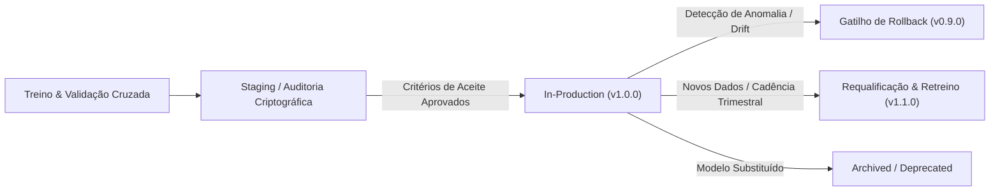

# Governança de Ciclo de Vida do Modelo e Model Registry
## Arquitetura de Versionamento, Rollback e Requalificação Contínua (Sprint 5)

**Projeto:** Sanidade Vegetal (SugarVision) — Diagnóstico Fitopatológico em Cana-de-Açúcar  
**Sprint:** 5 — Governança de MLOps e Prontidão para Produção  
**Responsável Técnica:** Elisa Alcântara (Engenharia de Machine Learning & MLOps)  
**Status:** **HOMOLOGADO PARA PRODUÇÃO**  
**Versão Ativa do Modelo:** `v1.0.0` (SHA-256: `0100a66f15c5e7601ff578efaabaea080bebac00a9f9ec170cd8e31fb27e3e02`)

---

## 1. Visão Geral e Princípios de MLOps

O sistema de governança de modelos do **SugarVision** implementa uma arquitetura robusta de **Model Registry** federado, assegurando rastreabilidade bidirecional entre:
1. **Dados de Origem:** Hash SHA-256 e partição da Tabela Analítica Base (`abt_sanidade_vegetal.csv`).
2. **Código e Pipeline:** Commit Git rastreável e código-fonte auditado do estimador.
3. **Artefato de Inferência:** Binário serializado (`models/sanidade_vegetal_pipeline_final.joblib`) com assinatura criptográfica.
4. **Contrato de Dados:** Validação estrita de entrada e saída via [`models/model_schema_contract.json`](file:///c:/Users/elisa/OneDrive/Documentos/Sanidade-Vegetal/models/model_schema_contract.json).

---

## 2. Taxonomia dos Estágios do Ciclo de Vida

Todo artefato de modelo supervisionado percorre obrigatoriamente 5 estágios formais no [`models/model_registry.json`](file:///c:/Users/elisa/OneDrive/Documentos/Sanidade-Vegetal/models/model_registry.json):

| Estágio | Definição Operacional | Permissão de Inferência em Campo |
| :--- | :--- | :---: |
| **Development** | Artefato gerado durante experimentos preliminares de P&D ou estudos exploratórios de hiperparâmetros. | ❌ Proibido |
| **Staging** | Candidato a campeão que superou os benchmarks e está em fase de homologação e auditoria de contratos de schema. | ⚠️ Ambiente Sandbox |
| **In-Production** | Versão homologada ativa, servindo predições para dispositivos de borda e sistemas agrícolas. | ✅ Autorizado |
| **Archived** | Versões anteriores preservadas com seus respectivos hashes SHA-256 para auditoria histórica e reprodutibilidade. | ❌ Desativado |
| **Deprecated** | Versões que apresentaram vulnerabilidades conceituais, leakage ou obsolescência matemática severa. | ❌ Revogado |

---

## 3. Política de Versionamento Semântico para Modelos (Model-SemVer)

O versionamento segue a regra rigorosa `MAJOR.MINOR.PATCH`:

* **MAJOR (X.0.0)**:
  * Alterações estruturais no contrato de dados (adição, remoção ou mudança de tipagem de features).
  * Substituição da família algorítmica (ex.: substituição de SVM por Rede Neural Convolucional ou ViT).
* **MINOR (1.X.0)**:
  * Re-treino completo do pipeline sobre novas safras ou lotes adicionais de dados, preservando o contrato de schema.
  * Modificação dos hiperparâmetros campeões no Grid Search.
* **PATCH (1.0.X)**:
  * Re-calibração de limiares de probabilidade (Platt Scaling) ou ajustes na camada de sanitização do pré-processador sem alterar o espaço de pesos do SVM.

---

## 4. Portões de Promoção (*Promotion Gates*) para Produção

Para que um modelo transite do estágio de **Staging** para **In-Production**, ele deve satisfazer a 100% dos critérios objetivos:

1. **Desempenho Agronômico Mínimo:**
   * $F_1\text{-Macro} \ge 0.55$ no conjunto de teste independente cego.
   * Acurácia Global $\ge 58.0\%$.
   * Recall da classe crítica de Ferrugem (*Rust*) $\ge 0.60$.
2. **Integridade de Software e Infraestrutura:**
   * Aprovação de 100% dos testes unitários de integração (`test_final_pipeline_serialization.py`).
   * Des-serialização limpa sem dependência de módulos de treino externos.
   * Tempo de inferência por amostra menor que 50 ms.
3. **Governança Documental:**
   * Registro completo no `model_registry.json`.
   * Existência do manifesto `.json` com hash criptográfico SHA-256 verificado.

---

## 5. Procedimento Operacional de Rollback

Caso o modelo em produção apresente comportamento anômalo em campo, a reversão é executada segundo os critérios definidos na governança:

### 5.1 Gatilhos de Acionamento Imediato de Rollback
* **Data Drift Excessivo:** Índice de Estabilidade Populacional ($PSI > 0.25$) entre a distribuição de treino e a entrada de inferência.
* **Alta Taxa de Rejeição de Schema:** Mais de $5.0% $ das imagens recebidas em um lote rejeitadas pelo [`SchemaValidator`](file:///c:/Users/elisa/OneDrive/Documentos/Sanidade-Vegetal/src/schema_validator.py).
* **Degradação de Latência:** Latência no percentil 95 ($P_{95} > 200\text{ ms}$).
* **Degradação de Qualidade Diagnosticada:** Queda abrupta de performance em auditorias de campo por especialistas ($F_1\text{-Macro} < 0.50$).

### 5.2 Fluxo de Execução do Rollback
1. O serviço de monitoramento dispara o alerta de violação de SLA.
2. O ponteiro de produção em [`models/model_registry.json`](file:///c:/Users/elisa/OneDrive/Documentos/Sanidade-Vegetal/models/model_registry.json) é apontado para a versão indicada em `rollback_target_version` (`v0.9.0` — `models/svm_pipeline_optimal.joblib`).
3. O serviço [`ProductionInferenceService`](file:///c:/Users/elisa/OneDrive/Documentos/Sanidade-Vegetal/src/schema_validator.py) recarrega o modelo homologado de backup.
4. É emitido um relatório de incidente contendo o snapshot das predições anômalas para investigação da equipe de MLOps.

---

## 6. Critérios e Rotina de Requalificação (Trigger de Retreino)

A requalificação periódica do modelo evita a obsolescência temporal do estimador através de três diretrizes:

1. **Volume de Novos Dados:** Adição de mais de **500 novas imagens** diagnosticadas e validadas por fitopatologistas agrônomos.
2. **Concept Drift Estatístico:** Teste bicaudal de Kolmogorov-Smirnov ($p < 0.01$) detectando divergência na distribuição dos descritores visuais em relação à safra anterior.
3. **Janela Temporal Máxima:** Obrigatoriedade de ciclo de re-treinamento a cada **90 dias** (acompanhando o ciclo fenológico da cana-de-açúcar).
