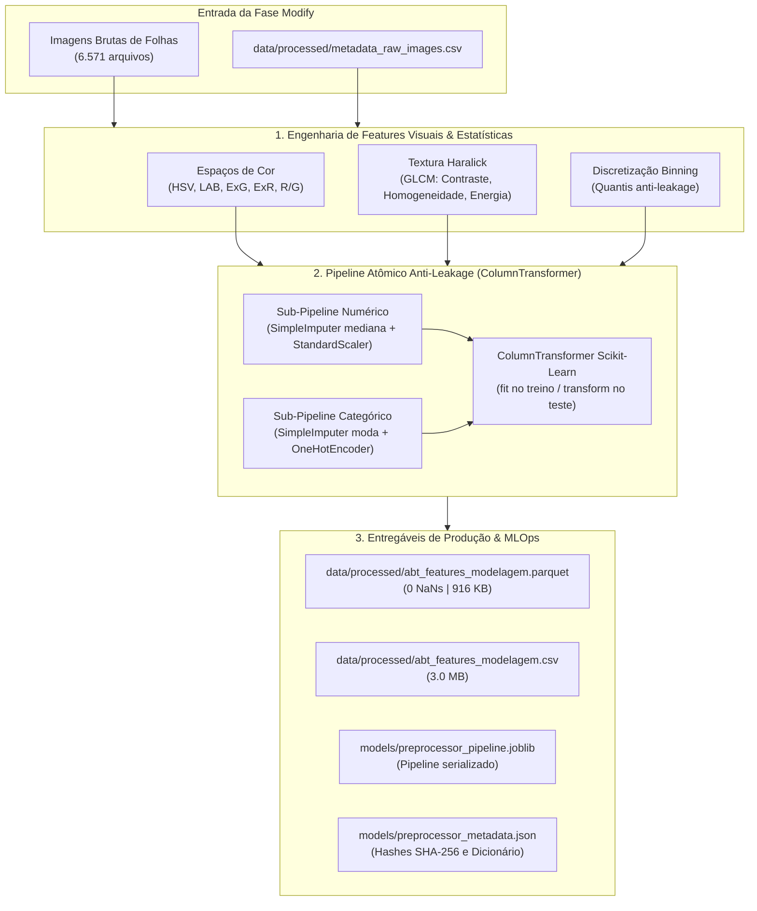

# 🔬 Inventário e Dossiê Completo da Fase Modify (SEMMA — Sprint 2)

**Projeto:** Sanidade-Vegetal (SugarVision)  
**Metodologia:** Framework SEMMA (*Sample, Explore, Modify, Model, Assess*)  
**Etapa:** **Modify** (Engenharia de Features, Transformação, Pipeline Atômico e Consolidação da ABT)  
**Ciclo:** Sprint 2  
**Status:** **100% Concluído e Auditado**  
**Data de Homologação:** Setembro de 2026  

---

## 📌 1. Visão Geral da Fase Modify

Na metodologia SEMMA, a fase **Modify** transforma os dados brutos e explorados em representações matemáticas discriminatórias, limpas e escaladas, prontas para algoritmos de aprendizado de máquina supervisionados. 

No projeto **SugarVision**, a fase Modify resolveu os principais desafios de visão computacional agrícola e modelagem preditiva tabular:
1. **Engenharia de Features Visuais:** Conversão para múltiplos espaços de cor ($RGB \rightarrow HSV, CIELAB$), índices biofísicos de vegetação ($ExG, ExR$), razões espectrais de necrose ($R/G, G/B$) e análise de textura via Matriz de Co-ocorrência em Níveis de Cinza (GLCM / Haralick).
2. **Discretização e Binning:** Redução de assimetria de metadados (`size_kb`, `laplacian_var`) com particionamento em quantis e isolamento estrito contra *data leakage*.
3. **Pipeline Atômico com `ColumnTransformer`:** Encadeamento de imputação mediana, padronização $z$-score e codificação *One-Hot*, governado pela **Regra de Ouro do Fit** (`fit` exclusivo na partição de treino).
4. **Consolidação da ABT Final:** Geração da *Analytical Base Table* com **6.571 instâncias**, **40 colunas**, **0 NaNs**, com validação de prontidão para a Fase *Model* (SVM com `GridSearchCV`).



---

## 📓 2. Catálogo de Notebooks Jupyter (`notebooks/`)

| Notebook | Descrição e Finalidade | Responsável | Entradas / Saídas |
| :--- | :--- | :---: | :--- |
| **[`06_pipeline_atomico_columntransformer.ipynb`](file:///c:/Users/fmsar/OneDrive/Documentos/GitHub/jogo_damas/Sanidade-Vegetal/notebooks/06_pipeline_atomico_columntransformer.ipynb)** | **Pipeline Atômico de Pré-processamento:** Fluxo unificado no Scikit-Learn com `ColumnTransformer`. Executa imputação por mediana, normalização $z$-score, One-Hot Encoding, validação empírica anti-leakage e persistência MLOps. | Elisa (`EA`) | **In:** `abt_sanidade_vegetal.csv`<br>**Out:** `preprocessor_pipeline.joblib`, `preprocessor_metadata.json` |
| **[`07_consolidacao_exportacao_abt_final.ipynb`](file:///c:/Users/fmsar/OneDrive/Documentos/GitHub/jogo_damas/Sanidade-Vegetal/notebooks/07_consolidacao_exportacao_abt_final.ipynb)** | **Consolidação e Exportação da ABT Final:** Aplicação integral do pipeline nas 6.571 instâncias. Auditoria de integridade (0 NaNs em 100% das 40 colunas), benchmark de desempenho I/O (Parquet vs CSV) e teste contratual de prontidão com `GridSearchCV`. | Elisa (`EA`) | **In:** `abt_sanidade_vegetal.csv`, `preprocessor_pipeline.joblib`<br>**Out:** `abt_features_modelagem.parquet`, `manifest.json` |
| **[`03_sprint2_modify_pipeline.ipynb`](file:///c:/Users/fmsar/OneDrive/Documentos/GitHub/jogo_damas/Sanidade-Vegetal/notebooks/03_sprint2_modify_pipeline.ipynb)** | **Notebook de Disparo Integrado:** Interface rápida para execução dos scripts de extração e rotinas de validação de ponta a ponta. | Squad 2 | **Ação:** Chama scripts de `src/` e exibe logs diagnósticos. |

---

## ⚙️ 3. Módulos e Scripts Executáveis em Python (`src/`)

### 3.1. Engenharia de Features Visuais e Índices Espectrais
* **Arquivo:** [`src/feature_engineering_visual.py`](file:///c:/Users/fmsar/OneDrive/Documentos/GitHub/jogo_damas/Sanidade-Vegetal/src/feature_engineering_visual.py)
* **Responsável:** Cesar (Lead Técnico & Visão Computacional)
* **Funcionalidades:**
  * `rgb_to_hsv_metrics(img_rgb)`: Converte para HSV e calcula média/desvio-padrão de Matiz (*Hue*) e Saturação.
  * `rgb_to_cielab_metrics(img_rgb)`: Converte para CIELAB para medição perceptiva de luminância $L^*$ e componentes $a^*$ (verde-vermelho) e $b^*$ (azul-amarelo).
  * `calculate_spectral_indices(img_rgb)`: Calcula $ExG = 2G - R - B$ (Índice de Excesso de Verde), $ExR = 1.4R - G$ e as razões $R/G$ e $G/B$ para detecção de clorose e tecidos necrosados.
  * `extract_haralick_glcm_features(img_gray)`: Calcula a GLCM em 4 ângulos ($0^\circ, 45^\circ, 90^\circ, 135^\circ$) e extrai Contraste, Dissimilaridade, Homogeneidade e Energia, gerando a média invariante à rotação.

### 3.2. Discretização Estatística de Variáveis Contínuas (Binning)
* **Arquivo:** [`src/discretizacao_binning.py`](file:///c:/Users/fmsar/OneDrive/Documentos/GitHub/jogo_damas/Sanidade-Vegetal/src/discretizacao_binning.py)
* **Responsável:** Cesar
* **Funcionalidades:**
  * Diagnóstico de assimetria (*skewness*) e curtose para `size_kb`, `laplacian_var`, `aspect_ratio` e `resolution_mp`.
  * Implementação comparativa de `KBinsDiscretizer` com estratégias `uniform`, `quantile` e `kmeans`.
  * Isolamento estrito de *bins*: cálculo de percentis unicamente sobre o *Train Split* com projeção direta em Validação e Teste.

### 3.3. Pipeline Atômico de Pré-processamento (Anti-Leakage)
* **Arquivo:** [`src/atomic_pipeline_preprocessing.py`](file:///c:/Users/fmsar/OneDrive/Documentos/GitHub/jogo_damas/Sanidade-Vegetal/src/atomic_pipeline_preprocessing.py)
* **Responsável:** Elisa (`EA`)
* **Funcionalidades:**
  * Construção do `ColumnTransformer` integrando sub-pipeline numérico (`SimpleImputer(strategy='median')` + `StandardScaler`) e categórico (`SimpleImputer(strategy='most_frequent')` + `OneHotEncoder(handle_unknown='ignore')`).
  * Teste unitário anti-vazamento: verificação de que os parâmetros $\mu$ e $\sigma$ vêm estritamente da partição de treino.
  * Serialização atômica MLOps com `joblib.dump(..., compress=3)` e exportação de metadados em JSON.

### 3.4. Consolidação e Exportação da ABT Final
* **Arquivo:** [`src/export_final_modeling_abt.py`](file:///c:/Users/fmsar/OneDrive/Documentos/GitHub/jogo_damas/Sanidade-Vegetal/src/export_final_modeling_abt.py)
* **Responsável:** Elisa (`EA`)
* **Funcionalidades:**
  * Processamento em lote das 6.571 linhas da base preliminar.
  * Auditoria automatizada de integridade (verificação assertiva de `df.isna().sum().sum() == 0`).
  * Benchmark comparativo de performance de I/O e pegada em disco (Parquet vs CSV).
  * Geração do manifesto de auditoria criptográfica com hashes SHA-256.
  * Smoke test de prontidão para a Sprint 3 executando `GridSearchCV` com estimador linear `SVC`.

---

## 📂 4. Diretórios de Documentação Metodológica

Cada frente da Fase Modify possui uma pasta de documentação aprofundada com relatórios técnicos, fórmulas e checklists:

1. **Engenharia de Atributos e Descritores Visuais:**
   * [`Engenharia de Atributos e Descritores Visuais/README.md`](file:///c:/Users/fmsar/OneDrive/Documentos/GitHub/jogo_damas/Sanidade-Vegetal/Engenharia%20de%20Atributos%20e%20Descritores%20Visuais/README.md)
   * [`engenharia_descritores_cromaticos_e_indices.md`](file:///c:/Users/fmsar/OneDrive/Documentos/GitHub/jogo_damas/Sanidade-Vegetal/Engenharia%20de%20Atributos%20e%20Descritores%20Visuais/engenharia_descritores_cromaticos_e_indices.md): Fundamentação biológica e ótica do $ExG$, HSV e CIELAB.
   * [`extracao_textura_glcm_e_rugosidade.md`](file:///c:/Users/fmsar/OneDrive/Documentos/GitHub/jogo_damas/Sanidade-Vegetal/Engenharia%20de%20Atributos%20e%20Descritores%20Visuais/extracao_textura_glcm_e_rugosidade.md): Equações da matriz GLCM e propriedades de Haralick.
   * [`discretizacao_variaveis_continuas_binning.md`](file:///c:/Users/fmsar/OneDrive/Documentos/GitHub/jogo_damas/Sanidade-Vegetal/Engenharia%20de%20Atributos%20e%20Descritores%20Visuais/discretizacao_variaveis_continuas_binning.md): Análise de assimetria e intervalos ótimos de corte.

2. **Pipeline Atômico e Anti-Leakage:**
   * [`Pipeline Atômico de Pré-processamento e Anti-Leakage/README.md`](file:///c:/Users/fmsar/OneDrive/Documentos/GitHub/jogo_damas/Sanidade-Vegetal/Pipeline%20At%C3%B4mico%20de%20Pr%C3%A9-processamento%20e%20Anti-Leakage/README.md)
   * [`pipeline_atomico_columntransformer.md`](file:///c:/Users/fmsar/OneDrive/Documentos/GitHub/jogo_damas/Sanidade-Vegetal/Pipeline%20At%C3%B4mico%20de%20Pr%C3%A9-processamento%20e%20Anti-Leakage/pipeline_atomico_columntransformer.md): Arquitetura dos transformadores, prova matemática anti-leakage e governança.

3. **Consolidação e Exportação da ABT Final:**
   * [`Consolidação e Exportação da ABT Final/README.md`](file:///c:/Users/fmsar/OneDrive/Documentos/GitHub/jogo_damas/Sanidade-Vegetal/Consolida%C3%A7%C3%A3o%20e%20Exporta%C3%A7%C3%A3o%20da%20ABT%20Final/README.md)
   * [`consolidacao_exportacao_abt_final.md`](file:///c:/Users/fmsar/OneDrive/Documentos/GitHub/jogo_damas/Sanidade-Vegetal/Consolida%C3%A7%C3%A3o%20e%20Exporta%C3%A7%C3%A3o%20da%20ABT%20Final/consolidacao_exportacao_abt_final.md): Dicionário das 40 variáveis consolidadas, benchmarks e contrato de integração com SVM.

---

## 📊 5. Artefatos Finais Persistidos em Disco

### 5.1. Bases de Dados Consolidadas (`data/processed/`)
* **`data/processed/abt_features_modelagem.parquet`** (916,92 KB): Formato colunar otimizado com compressão Snappy, leitura 3,26× mais rápida que CSV e tipagem binária preservada.
* **`data/processed/abt_features_modelagem.csv`** (2.989,66 KB): Cópia tabular para interoperabilidade e auditorias visuais externas.
* **`data/processed/abt_features_modelagem_manifest.json`**: Manifesto com contagem exata de linhas (6.571), colunas (40), ausência de nulos e hashes SHA-256.

### 5.2. Objetos de Modelo e MLOps (`models/`)
* **`models/preprocessor_pipeline.joblib`** (2,58 KB): Pipeline `ColumnTransformer` serializado com compressão ZLIB, permitindo reconstruir as 35 features preparadas em ambiente de inferência com uma única chamada `.transform()`.
* **`models/preprocessor_metadata.json`**: Manifesto formal contendo o schema de entrada, nomes exatos de features geradas por `get_feature_names_out()`, versões de bibliotecas (`scikit-learn 1.4+`) e hash do arquivo binário.

### 5.3. Gráficos Diagnósticos (`docs/figures/`)
* [`docs/figures/sprint2_analise_cromaticas_hsv_exg.png`](file:///c:/Users/fmsar/OneDrive/Documentos/GitHub/jogo_damas/Sanidade-Vegetal/docs/figures/sprint2_analise_cromaticas_hsv_exg.png): Dispersão e densidade dos índices $ExG$ e canais HSV.
* [`docs/figures/sprint2_analise_texturas_glcm_haralick.png`](file:///c:/Users/fmsar/OneDrive/Documentos/GitHub/jogo_damas/Sanidade-Vegetal/docs/figures/sprint2_analise_texturas_glcm_haralick.png): Padrões de textura e contraste foliar entre folhas sadias e enferrujadas.
* [`docs/figures/sprint2_distribuicao_assimetria_metadados.png`](file:///c:/Users/fmsar/OneDrive/Documentos/GitHub/jogo_damas/Sanidade-Vegetal/docs/figures/sprint2_distribuicao_assimetria_metadados.png): Histograma de assimetria das variáveis antes do binning.
* [`docs/figures/sprint2_comparacao_binning_uniform_vs_quantile.png`](file:///c:/Users/fmsar/OneDrive/Documentos/GitHub/jogo_damas/Sanidade-Vegetal/docs/figures/sprint2_comparacao_binning_uniform_vs_quantile.png): Comparação dos métodos de discretização.

---

## 🚀 6. Guia Rápido de Reproducibilidade

Para reexecutar toda a Fase Modify do zero e regenerar todos os artefatos:

```powershell
# 1. Ativar o ambiente virtual do projeto
.\venv\Scripts\activate

# 2. Executar a Engenharia de Features Visuais e Índices Espectrais
python .\src\feature_engineering_visual.py

# 3. Executar o Módulo de Discretização e Binning
python .\src\discretizacao_binning.py

# 4. Ajustar e Serializar o Pipeline Atômico ColumnTransformer (Anti-Leakage)
python .\src\atomic_pipeline_preprocessing.py

# 5. Consolidar e Exportar a ABT Final (Parquet + CSV + Auditoria 0 NaNs)
python .\src\export_final_modeling_abt.py
```
Todos os artefatos serão validados e salvos nas respectivas pastas (`data/processed/`, `models/` e `docs/figures/`).
