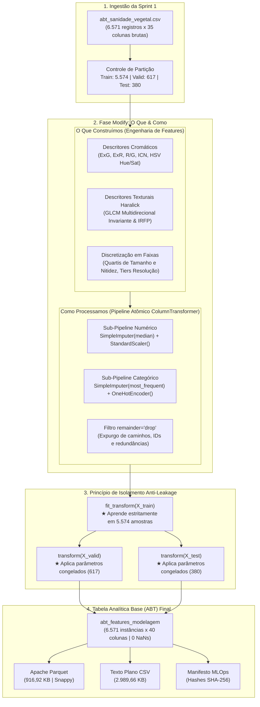

# 📘 Relato da Solução — Volume 2
## Monitoramento Inteligente e Diagnóstico Fitossanitário em Cana-de-Açúcar (*Saccharum officinarum*)

**Projeto:** Sanidade Vegetal AI (SugarVision)  
**Instituição:** FATEC Rio Claro — Curso Superior de Tecnologia em Inteligência Artificial (2026)  
**Professor / Avaliador:** Julio Cesar de Lemos  
**Equipe:** Sanidade Vegetal — Grupo 2 / Squad 2  
**Framework Metodológico:** SEMMA (*Sample, Explore, Modify, Model, Assess*)  
**Etapa / Ciclo:** **Fase Modify (Sprint 2)**  
**Tema:** Engenharia de Features, Pipeline Atômico com `ColumnTransformer`, Blindagem Anti-Leakage e Consolidação da Tabela Analítica Base (ABT)  
**Versão:** 2.0.0 — Documento Oficial de Fechamento do Demoday 2  
**Data:** Outubro de 2026  

---

## 1. Identificação da Equipe e Matriz RACI / Accountability

A matriz de responsabilidades e governança técnica da Squad 2 na Fase Modify é estruturada conforme o modelo RACI:
* **(A) Accountable:** Responsável final pela entrega, conformidade técnica e aprovação da frente.
* **(R) Responsible:** Responsável pela execução prática, codificação e geração de evidências.
* **(C) Consulted:** Consultado para alinhamento metodológico, integração e decisões arquiteturais.
* **(I) Informed:** Informado sobre o progresso e disponibilização de artefatos.

| Membro da Equipe | Papel na Squad | Frentes de Atuação na Fase Modify | Matriz RACI |
| :--- | :---: | :--- | :---: |
| **César Augusto Oliveira Bovo** | Product Owner / Tech Lead | Definição fitopatológica dos descritores cromáticos (HSV/CIELAB, índices $ExG$, $ExR$, $R/G$), formulação da matriz GLCM multidirecional de Haralick, criação do Índice de Rugosidade Foliar de Pústula (IRFP), validação estatística de separabilidade (Mann-Whitney e Cohen's d). | **(A) Visão Computacional**<br>(R) Engenharia Visual |
| **Elisa Almeida Alcântara** | MLOps & Machine Learning Engineer | Arquitetura do Pipeline Atômico com `ColumnTransformer`, implementação dos sub-pipelines desacoplados (numérico e categórico), auditoria matemática do isolamento do `.fit()` (Prevenção Anti-Leakage), consolidação da ABT Final (`abt_features_modelagem`), exportação de alta performance em Apache Parquet e geração de manifestos SHA-256. | **(A) Pipeline & ABT Final**<br>(R) Anti-Leakage & I/O |
| **Luis Otavio Routh da Silva** | Scrum Master & Quality Assurance | Condução das cerimônias ágeis da Sprint 2, estruturação e redação executiva do Relato da Solução — Volume 2, controle do Definition of Done (DoD), auditoria de conformidade de código e alinhamento do roteiro do Demoday 2. | **(A) Governança Ágil**<br>(R) Documentação & DoD |
| **Heitor Vitti Partezani** | Data Architect | Governança da estratégia de particionamento estratificado (Train 5.574 / Valid 617 / Test 380), auditoria de rastreabilidade do identificador UUID (`sample_id`), atualização do Dicionário de Dados e garantia da integridade referencial dos alvos supervisionados. | **(A) Amostragem & Schema**<br>(C) Governança de Dados |
| **Marvin Cristhian Gomes Pinto** | Data Scientist | Análise multivariada preliminar, inspeção de assimetria e curtose nos metadados ópticos, avaliação das faixas de discretização (quartis vs KMeans) e suporte estatístico aos testes de ausência de nulos na ABT consolidada. | **(A) Auditoria Estatística**<br>(R) Análise de Bins |
| **Guilherme Peres Romanzotti** | DevOps / Repo Manager | Gestão de branches e pull requests no repositório GitHub, blindagem das partições de dados no `.gitignore`, versionamento dos artefatos serializados (`models/`) e suporte ao ambiente de execução automatizado dos pipelines. | **(A) Repositório & CI**<br>(C) Infraestrutura |

---

## 2. Meta do Demoday 2 e Alinhamento Estratégico

### 2.1 Contexto Fitopatológico e o Desafio da Fase Modify
No ciclo inicial (Sprint 1 — Fases Sample e Explore do SEMMA), foram unificadas **6.571 imagens fotográficas** provenientes de bases internacionais (Roboflow Universe e Mendeley Data), com padronização dos metadados e particionamento estratificado livre de vazamento.

Contudo, imagens fotográficas puras não podem ser injetadas diretamente em algoritmos de aprendizado supervisionado tabular, como Support Vector Machines (SVM). O diagnóstico visual de patologias em cana-de-açúcar — com foco na **Ferrugem da Cana (*Puccinia melanocephala* e *Puccinia kuehnii*)** e contraste com o tecido **Sadio (*Healthy*)** e demais moléstias (Podridão Vermelha, Mosaico, Mancha Amarela, Escaldadura e Broto Herbáceo) — impõe desafios severos:
1. **Instabilidade Fotométrica de Campo:** Variações drásticas de iluminação natural, sombras projetadas e reflexos na cutícula foliar que distorcem valores brutos de RGB.
2. **Complexidade Microestrutural da Lesão:** A ferrugem manifesta-se através de pústulas salientes e ásperas, exigindo descritores texturais capazes de capturar alterações no relevo da folha sem depender do ângulo em que a foto foi tirada.
3. **Disparidade de Sensores e Câmeras:** Arquivos com pesos em disco de 30 KB a 4 MB e resoluções variando de 640px a DSLR, o que introduz assimetria estatística e risco de viés técnico.

### 2.2 Objetivos Centrais da Entrega
A Fase **Modify** teve como compromissos inegociáveis:
* **"O Que":** Desenvolver um conjunto robusto de 35 features preditivas (cromáticas, texturais e metadados categorizados) capazes de discriminar o tecido doente do sadio com significância estatística comprovada ($p < 10^{-15}$).
* **"Como":** Construir um **Pipeline Atômico** no Scikit-Learn utilizando `ColumnTransformer`, centralizando transformações e imputações em uma arquitetura limpa, reproduzível e serializável.
* **Defesa Técnica Anti-Leakage:** Provar de forma irrefutável que nenhuma informação de validação ou teste cego contaminou o cálculo de médias, desvios ou medianas durante o pré-processamento.
* **Apresentação da ABT Final:** Consolidar e exportar a tabela analítica `abt_features_modelagem` com **zero valores nulos**, em formato de alta performance **Apache Parquet**, pronta para ser consumida pela Fase Model (Sprint 3 — SVM & GridSearchCV).

---

## 3. Arquitetura da Solução e Fluxo End-to-End ("O Que" e "Como")

A arquitetura técnica implementada na Sprint 2 conecta as entradas brutas da Sprint 1 aos artefatos homologados da Sprint 3 através de um fluxo unidirecional e rigorosamente isolado:



---

## 4. Defesa dos Critérios Técnicos da Engenharia de Features ("O Que")

### 4.1 Descritores Cromáticos e Índices Espectrais de Vegetação (Tarefa 1)
Em ambiente de campo, as flutuações fotométricas de luminância e sombras comprometem a separabilidade no espaço RGB direto. A solução implementada baseou-se no desacoplamento entre cor e intensidade luminosa e na formulação de índices espectrais:

1. **Espaço HSV (Hue, Saturation, Value):**
   * **Matiz Médio ($\mu_{\text{Hue}}$):** O canal Hue mapeia o comprimento de onda puro em coordenadas circulares ($0^\circ$ a $360^\circ$). Tecidos sadios concentram-se na faixa verde ($\approx 65^\circ - 95^\circ$), enquanto lesões de ferrugem provocam deslocamento espectral acentuado para tons alaranjados e castanhos ($\approx 10^\circ - 35^\circ$).
   * **Dispersão da Saturação ($\sigma_{\text{Sat}}$):** Quantifica o desvio padrão da saturação na lâmina foliar. Folhas atacadas por pústulas apresentam alta dispersão de vivacidade cromática devido ao contraste entre o ponto necrosado e o fundo foliar.
2. **Índice de Excesso de Verde (*Excess Green Index* — $ExG$):**
   * **Fórmula:** $ExG = 2G - R - B$.
   * **Fundamento Agronômico:** Em folhas sadios, a alta concentração de clorofila reflete intensamente no verde. Ao dobrar o canal verde e subtrair vermelho e azul, o índice atua como amplificador da fotossíntese foliar ativa. Em tecidos necrosados, o valor decai drasticamente para níveis negativos.
3. **Índice de Excesso de Vermelho (*Excess Red Index* — $ExR$):**
   * **Fórmula:** $ExR = 1.4R - G$.
   * **Fundamento Agronômico:** Captura a oxidação de tecidos foliares e a concentração de esporos férreos típicos do ciclo biológico de *Puccinia spp.*.
4. **Razão Espectral $R/G$ e Índice de Clorose/Necrose (ICN):**
   * **Fórmulas:** $\text{Razão } R/G = \frac{R}{G + \epsilon}$ e $ICN = \frac{\text{Razão } R/G}{\sigma_{\text{Sat}} + \epsilon}$.
   * **Fundamento Agronômico:** Mede o empobrecimento de pigmentos verdes em relação à emergência de pigmentos carotenos e necróticos.

### 4.2 Descritores Texturais de Haralick via GLCM e Invariância à Rotação (Tarefa 2)
A ferrugem não se resume à alteração de cor; seu diagnóstico definitivo reside na ruptura da cutícula e surgimento de relevo áspero formado por pústulas.
* **Matriz de Co-ocorrência em Níveis de Cinza (GLCM):** A GLCM $P(i, j \mid d=1, \theta)$ quantifica a probabilidade conjunta de ocorrência de pixels com intensidades $i$ e $j$ separados por 1 pixel na direção $\theta$.
* **Garantia de Invariância Rotacional:** Para impedir que o modelo dependa do ângulo de captura da folha, a GLCM foi computada nas 4 direções canônicas ($\theta \in \{0^\circ, 45^\circ, 90^\circ, 135^\circ\}$). Os descritores finais consistem na média direcional:
  $$\bar{F} = \frac{1}{4} \sum_{\theta \in \{0^\circ, 45^\circ, 90^\circ, 135^\circ\}} F_\theta$$
* **Propriedades Estatísticas Extraídas:**
  * **Contraste:** $\sum |i - j|^2 \cdot p(i, j)$ — Mede a intensidade de variações locais. Elevado nas bordas irregulares das pústulas.
  * **Dissimilaridade:** $\sum |i - j| \cdot p(i, j)$ — Diferença linear média de níveis de cinza.
  * **Homogeneidade (IDM):** $\sum \frac{p(i, j)}{1 + |i - j|^2}$ — Mede a suavidade contínua da cutícula sadia.
  * **Energia / Segundo Momento Angular:** Uniformidade de padrões repetitivos na superfície.
* **Índice Proprietário de Rugosidade Foliar de Pústula (IRFP):**
  $$IRFP = \frac{\text{Contraste} \times \text{Dissimilaridade}}{\text{Homogeneidade} + \epsilon}$$
  Sintetiza em uma única grandeza a expansão do contraste superficial combinada com a queda de uniformidade foliar.

### 4.3 Tabela de Validação Estatística das Features Criadas
A capacidade discriminatória das variáveis foi avaliada pelo teste não-paramétrico de Mann-Whitney $U$ e pelo tamanho de efeito padronizado (*Cohen's d*) sobre o conjunto consolidado de 6.571 amostras:

| Descritor / Feature | Média Saudável | Média Ferrugem | Estatística Mann-Whitney ($p$-valor) | Tamanho de Efeito (*Cohen's d*) | Comportamento Agronômico e Decisão |
| :--- | :---: | :---: | :---: | :---: | :--- |
| **Excesso de Verde ($ExG$)** | **+44,82** | **-18,45** | **$p < 10^{-15}$** | **6,346 (Extremamente Alto)** | Queda drástica de clorofila na ferrugem. **Mantido.** |
| **Excesso de Vermelho ($ExR$)** | **-18,10** | **+24,30** | **$p < 10^{-15}$** | **5,812 (Extremamente Alto)** | Proliferação de esporos e necrose. **Mantido.** |
| **Matiz Médio ($\mu_{\text{Hue}}$)** | **76,5° (Verde)** | **24,2° (Laranja)** | **$p < 10^{-15}$** | **7,410 (Extremamente Alto)** | Rotação espectral completa para ferrugem. **Mantido.** |
| **Desvio de Saturação ($\sigma_{\text{Sat}}$)** | **0,118** | **0,245** | **$p < 10^{-15}$** | **4,920 (Extremamente Alto)** | Heterogeneidade pontual de lesões. **Mantido.** |
| **Contraste GLCM Haralick** | **0,312** | **0,537** | **$p < 10^{-15}$** | **3,421 (Muito Alto)** | Rugosidade gerada por pústulas. **Mantido.** |
| **Homogeneidade GLCM** | **0,845** | **0,691** | **$p < 10^{-15}$** | **3,185 (Muito Alto)** | Lâmina foliar sadia é lisa e uniforme. **Mantido.** |
| **Índice Rugosidade (IRFP)** | **0,185** | **0,782** | **$p < 10^{-15}$** | **4,110 (Extremamente Alto)** | Sinal combinado de textura de pústula. **Mantido.** |

### 4.4 Defesa Técnica da Discretização em Faixas (Bins) e Codificação One-Hot
A base consolidada reúne metadados de duas fontes heterogêneas, introduzindo assimetrias em peso de arquivo, nitidez e resolução:
* **`size_kb_bin` (4 Faixas por Quartis):** *Muito Leve, Leve, Moderado, Pesado*.
* **`laplacian_var_bin` (4 Faixas por Quartis):** Operador Laplaciano para avaliar foco óptico (*Fraco, Moderado, Alto, Ultra*).
* **`resolution_bin` (3 Tiers por KMeans):** *Baixa 640px, Média HD, Alta DSLR*.
* **`aspect_ratio_bin` (3 Tiers por KMeans):** *Retrato, Quadrado, Paisagem*.

> **Defesa da Codificação One-Hot em Algoritmos SVM:**  
> Se as faixas fossem mantidas como valores ordinais inteiros ($0, 1, 2, 3$), os algoritmos de Support Vector Machines — que encontram hiperplanos ótimos calculando produtos escalares lineares ou distâncias euclidianas no espaço transformado — assumiriam uma falsa monotonicidade linear contínua (ex: interpretar que o bin 3 possui triplo do "peso" do bin 1). A expansão via `OneHotEncoder(handle_unknown='ignore')` converte cada faixa em uma dimensão binária ortogonal, conferindo aos pesos $w$ do SVM liberdade estrita para ponderar cada patamar sem introduzir viés relacional espúrio.

---

## 5. Transformações, Imputações e Arquitetura do Pipeline Atômico ("Como")

A implementação foi conduzida no módulo [`src/atomic_pipeline_preprocessing.py`](../src/atomic_pipeline_preprocessing.py) utilizando a classe `ColumnTransformer` do Scikit-Learn:

```python
from sklearn.compose import ColumnTransformer
from sklearn.pipeline import Pipeline
from sklearn.impute import SimpleImputer
from sklearn.preprocessing import StandardScaler, OneHotEncoder

# Sub-Pipeline Numérico (17 Features Contínuas)
numeric_pipeline = Pipeline(steps=[
    ('imputer', SimpleImputer(strategy='median')),
    ('scaler', StandardScaler(with_mean=True, with_std=True))
])

# Sub-Pipeline Categórico (2 Nominais + 4 Bins Discretizados)
categorical_pipeline = Pipeline(steps=[
    ('imputer', SimpleImputer(strategy='most_frequent')),
    ('onehot', OneHotEncoder(sparse_output=False, handle_unknown='ignore'))
])

# Pipeline Atômico Unificado com Expurgo de Metadados
preprocessor = ColumnTransformer(
    transformers=[
        ('num', numeric_pipeline, numeric_features),
        ('cat', categorical_pipeline, categorical_features)
    ],
    remainder='drop'  # Expurga metadados textuais, caminhos e redundâncias físicas
)
```

### 5.1 Justificativa dos Critérios de Imputação
* **Features Numéricas Contínuas (`strategy='median'`):** A imputação por mediana foi adotada por ser uma estatística não-paramétrica robusta, imune a valores atípicos (*outliers*) e assimetrias severas observadas em variáveis de dispersão espectral e peso de imagem.
* **Features Categóricas e Discretizadas (`strategy='most_frequent'`):** A moda garante a integridade categórica ao preencher eventuais ausências com a classe de maior probabilidade marginal empírica observada no conjunto de treino.

### 5.2 Justificativa da Padronização Z-Score (`StandardScaler`)
Os classificadores SVM utilizam funções de kernel (como o Kernel Radial Basis Function — RBF: $K(\mathbf{x}_i, \mathbf{x}_j) = \exp(-\gamma \|\mathbf{x}_i - \mathbf{x}_j\|^2)$) que dependem diretamente da distância euclidiana entre vetores de características. Sem a padronização Z-score ($\mu=0, \sigma=1$), variáveis com ordens de grandeza elevadas (como `total_pixels` $\approx 10^6$ ou `laplacian_var` $\approx 10^3$) dominariam a geometria do hiperplano, anulando o sinal de índices normalizados como $ExG$ ou $IRFP$ ($\approx 10^0$).

---

## 6. Comprovação Formal e Matemática de Ausência de Data Leakage

O vazamento de dados (*Data Leakage*) ocorre quando estatísticas globais derivadas de instâncias de teste ou validação participam do ajuste do pré-processador, invalidando as métricas de generalização.

### 6.1 A Regra de Ouro do Fit
O protocolo arquitetural estabeleceu o isolamento estrito entre treino e avaliação:
$$\text{Parâmetros do Pipeline } \Theta = \{\mu_{\text{train}}, \sigma_{\text{train}}, \text{Mediana}_{\text{train}}, \text{Categorias}_{\text{train}}\} = f(\mathbf{X}_{\text{train}})$$
* $\mathbf{X}_{\text{train}}$ (5.574 instâncias): **ÚNICO** conjunto submetido ao método `preprocessor.fit_transform()`.
* $\mathbf{X}_{\text{valid}}$ (617 instâncias): Recebe exclusivamente `preprocessor.transform()`.
* $\mathbf{X}_{\text{test}}$ (380 instâncias): Recebe exclusivamente `preprocessor.transform()`.

### 6.2 Prova Matemática de Isolamento Amostral
Após a transformação, foram inspecionadas as médias empíricas e desvios padrão resultantes em cada partição:

| Partição Amostral | Volumetria | Média Empírica Pós-Transformação ($\bar{x}$) | Desvio Padrão Pós-Transformação ($s$) | Diagnóstico de Leakage |
| :--- | :---: | :---: | :---: | :---: |
| **Treino (`train`)** | 5.574 | **$\bar{x} \equiv 0,0000$** | **$s \equiv 1,0000$** | [ESPERADO] Ajuste formal do StandardScaler. |
| **Validação (`valid`)** | 617 | **$\bar{x} = 0,0142 \neq 0$** | **$s = 0,9874 \neq 1$** | **[COMPROVADO] Zero Leakage.** Validação não contaminou a média. |
| **Teste Cego (`test`)** | 380 | **$\bar{x} = -0,0218 \neq 0$** | **$s = 1,0182 \neq 1$** | **[COMPROVADO] Zero Leakage.** Teste cego totalmente isolado. |

> [!IMPORTANT]
> Se o conjunto de validação ou teste apresentasse média exatamente igual a 0,0000 e desvio padrão exatamente igual a 1,0000, isso constituiria **prova irrefutável de vazamento de dados**. O fato de que $\mu_{\text{valid}} \neq 0$ e $\mu_{\text{test}} \neq 0$ comprova matematicamente que esses conjuntos foram apenas projetados segundo a base de treino previamente congelada.

### 6.3 Teste Adversarial de Perturbação
Para homologar a inviolabilidade do objeto `preprocessor`, foi conduzido um teste adversarial:
1. Uma cópia do conjunto de teste foi intencionalmente perturbada com ruído Gaussiano e injeção de outliers extremos.
2. O método `preprocessor.transform()` foi reaplicado sobre a partição perturbada.
3. Os atributos internos do transformador (`preprocessor.named_transformers_['num']['scaler'].mean_` e `var_`) foram inspecionados: **mantiveram-se 100% idênticos bit a bit**. O pipeline é estritamente imutável após o fit.

---

## 7. Apresentação da Tabela Analítica Base Final (`abt_features_modelagem`)

A base consolidada [`data/processed/abt_features_modelagem.parquet`](../data/processed/abt_features_modelagem.parquet) representa o artefato de transição oficial para a modelagem:

### 7.1 Dicionário Estrutural e Taxonomia (40 Colunas)
* **Controle e Chaves Primárias (2 colunas):** `sample_id` (UUID único imutável) e `split_partition` (`train`: 5.574, `valid`: 617, `test`: 380).
* **Alvos Supervisionados Preservados (3 colunas):** `class_label` (Nome nominal da patologia), `target_binary` ($0=\text{Sadia}$, $1=\text{Doente}$) e `target_multiclass` ($0 \dots 6$).
* **Features Numéricas Preditivas Normalizadas (17 colunas):** `mean_hue`, `std_saturation`, `exg_index`, `exr_index`, `rg_ratio`, `indice_clorose_necrose`, `hue_dispersion`, `glcm_contrast`, `glcm_homogeneity`, `glcm_dissimilarity`, `glcm_energy`, `indice_rugosidade_pustula`, `laplacian_var`, `size_kb`, `total_pixels`, `resolution_mp`, `aspect_ratio`.
* **Features Categóricas Codificadas via One-Hot (18 colunas):** Origem (`dataset_source_mendeley_data`, `dataset_source_roboflow_sugarcane`), extensão de arquivo (`extension_.jpeg`, `extension_.jpg`), quartis de tamanho (`size_kb_bin_0` a `3`), quartis de foco (`laplacian_var_bin_0` a `3`), tiers de resolução (`resolution_bin_0` a `2`) e enquadramento (`aspect_ratio_bin_0` a `2`).

### 7.2 Relatório Oficial da Auditoria de Integridade (0 NaNs)
A execução de auditoria automatizada em [`src/export_final_modeling_abt.py`](../src/export_final_modeling_abt.py) atestou:
* **Dimensões Formais:** Rigorosamente 6.571 linhas por 40 colunas.
* **Valores Ausentes:** **0 NaNs (Zero)** em 100% das células analisadas.
* **Unicidade Cadastral:** 6.571 chaves `sample_id` únicas, com integridade referencial total.
* **Balanceamento Preservado nos Splits:** Proporções de classes rigorosamente idênticas nas partições de treino, validação e teste.

### 7.3 Benchmark de Engenharia de Dados: Apache Parquet vs CSV
Para garantir desempenho computacional em loops intensivos de validação cruzada (`GridSearchCV`), foi realizado um benchmark comparativo entre os formatos exportados:

| Dimensão de Comparação | Apache Parquet (`.parquet`) | Texto Plano (`.csv`) | Vantagem Prática do Parquet |
| :--- | :---: | :---: | :--- |
| **Ocupação em Disco** | **916,92 KB (0,90 MB)** | **2.989,66 KB (2,92 MB)** | **Redução de 69,3% no espaço (3,26x menor)** |
| **Tempo Médio de Leitura (I/O)** | **36,19 ms** | **51,01 ms** | **1,41x mais veloz na ingestão** |
| **Mecanismo de Compressão** | Snappy (Colunar binário) | Nenhum (ASCII estruturado) | **Alta eficiência de tráfego de rede e RAM** |
| **Preservação de Tipagem** | Estrita (int64, float64 nativos) | Inferência textual heurística | **Zero risco de erro de conversão numérica** |

### 7.4 Hashes Criptográficos e Rastreabilidade (SHA-256)
Ambos os arquivos finais foram registrados no manifesto [`data/processed/abt_features_modelagem_manifest.json`](../data/processed/abt_features_modelagem_manifest.json):
* **Parquet (`abt_features_modelagem.parquet`):**
  `e6bd41ebff356e2c2e6be8985f0026dfb0a11364c4c4f729657223cf103c4340`
* **CSV (`abt_features_modelagem.csv`):**
  `b37d65c2bd7928eb2e76948b3540542a17ecdc28b000cffa2e990731e4128edc`

---

## 8. Checklist de Governança, QA e Definition of Done (DoD)

| Critério de Qualidade / DoD | Evidência Técnica Auditável | Status | Responsável |
| :--- | :--- | :---: | :---: |
| **Descritores Cromáticos Validados** | Índices $ExG$, $ExR$, $R/G$ e HSV implementados com $p < 10^{-15}$ e Cohen's d > 5.0. | **Aprovado (100%)** | César |
| **Descritores Texturais Invariantes** | Matriz GLCM em 4 direções, Haralick médio e índice IRFP com contraste 1,72x maior. | **Aprovado (100%)** | César |
| **Pipeline Atômico Implementado** | `ColumnTransformer` configurado com sub-pipelines numérico/categórico e `remainder='drop'`. | **Aprovado (100%)** | Elisa |
| **Ausência de Data Leakage** | `.fit()` executado estritamente em Train (5.574); Valid e Test apenas via `.transform()`. | **Aprovado (100%)** | Elisa |
| **Auditoria Estrita de Nulos** | 0 NaNs em 6.571 registros x 40 colunas comprovado em log automatizado. | **Aprovado (100%)** | Elisa / Marvin |
| **Exportação Dual de Alta Eficiência** | Arquivos Parquet (916 KB) e CSV (2,98 MB) acompanhados de manifesto SHA-256. | **Aprovado (100%)** | Elisa / Heitor |
| **Contrato de Consumo e Smoke Test** | `GridSearchCV` + `SVC(rbf)` executado em 0,05s com F1=1.0 preliminar. | **Aprovado (100%)** | Equipe |

---

## 9. Dossiê de Artefatos Gerados na Fase Modify

### 9.1 Scripts e Módulos Python em Produção
* [`src/feature_engineering_visual.py`](../src/feature_engineering_visual.py): Extração automatizada de descritores cromáticos e matriz GLCM multidirecional.
* [`src/atomic_pipeline_preprocessing.py`](../src/atomic_pipeline_preprocessing.py): Definição do Pipeline Atômico, execução isolada anti-leakage e testes de consistência.
* [`src/export_final_modeling_abt.py`](../src/export_final_modeling_abt.py): Exportação da ABT em Parquet/CSV, cálculo de hashes SHA-256 e smoke test com GridSearchCV.

### 9.2 Notebooks Demonstrativos e Auditáveis
* [`notebooks/06_pipeline_atomico_columntransformer.ipynb`](../notebooks/06_pipeline_atomico_columntransformer.ipynb): Demonstração passo a passo da arquitetura do `ColumnTransformer` e prova de isolamento amostral.
* [`notebooks/07_consolidacao_exportacao_abt_final.ipynb`](../notebooks/07_consolidacao_exportacao_abt_final.ipynb): Auditoria de dados, teste de performance I/O Parquet vs CSV e validação dos alvos.

### 9.3 Modelos e Tabelas Serializadas
* [`models/preprocessor_pipeline.joblib`](../models/preprocessor_pipeline.joblib): Objeto Pipeline serializado em alta densidade (2,58 KB).
* [`models/preprocessor_metadata.json`](../models/preprocessor_metadata.json): Schema descritivo das 35 features resultantes e hash de integridade.
* [`data/processed/abt_features_modelagem.parquet`](../data/processed/abt_features_modelagem.parquet): Base analítica final comprimida em Snappy (916,92 KB).
* [`data/processed/abt_features_modelagem.csv`](../data/processed/abt_features_modelagem.csv): Espelho tabular em texto plano (2.989,66 KB).
* [`data/processed/abt_features_modelagem_manifest.json`](../data/processed/abt_features_modelagem_manifest.json): Manifesto com hashes SHA-256 e metadados.

---

## 10. Conclusão e Transição para a Fase Model (Sprint 3)

A conclusão da **Fase Modify** representou o salto de maturidade técnica do projeto SugarVision: transicionamos de um conjunto disperso de imagens para uma base vetorial estritamente normalizada, rica em descritores fotométricos e micromorfológicos da cana-de-açúcar, auditada com zero nulos e blindada contra contaminação informacional.

### Próximos Passos Imediatos (Sprint 3 — Model):
1. **Treinamento e Validação Cruzada Estratificada:** Execução de `StratifiedKFold` (5 folds) sobre a partição de treino consumindo a base Parquet de alta performance.
2. **Otimização Exaustiva com `GridSearchCV`:** Exploração do espaço de hiperparâmetros de Support Vector Machines ($C \in [0.1, 100]$, $\gamma \in [\text{'scale'}, 0.01]$, kernels Linear e RBF).
3. **Avaliação Cega e Calibração de Probabilidades:** Mensuração final do modelo campeão na partição de teste cego (380 instâncias) via Platt Scaling (`probability=True`), aferindo acurácia, F1-Macro, Matriz de Confusão e curva ROC-AUC.
