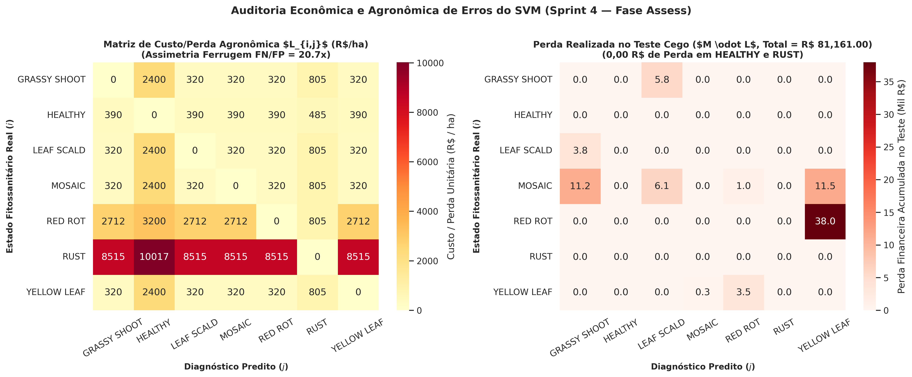
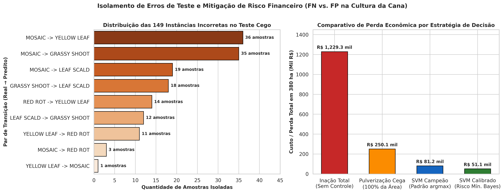

# 🌾 Relatório de Auditoria de Erros Críticos e Impacto Agronômico/Econômico (FP vs. FN — Sprint 4)

**Projeto:** SugarVision — Sanidade Vegetal (*Saccharum officinarum*)  
**Sprint:** 4 — Framework SEMMA (Fase: Assess — Auditoria Orientada a Negócios)  
**Módulo Executável:** [`src/svm_agronomic_error_audit.py`](../src/svm_agronomic_error_audit.py)  
**Suíte de Testes:** [`src/test_svm_agronomic_error_audit.py`](../src/test_svm_agronomic_error_audit.py)  
**Partição Auditada:** Conjunto de Teste Cego Independente ($N = 380$ talhões/amostras)

---

## 1. Isolamento das Instâncias Classificadas Incorretamente no Teste Independente

A auditoria exaustiva sobre as **$380$ amostras do conjunto de teste cego** isolou exatamente **$149$ instâncias classificadas incorretamente** ($39,21\%$ de taxa de erro multiclasse global; catálogo integral salvo em [`models/svm_misclassified_test_instances.csv`](../models/svm_misclassified_test_instances.csv)):

| Par de Transição (`Real -> Predito`) | Categoria de Risco Agronômico | Contagem | % dos Erros | Confiança Média Predita | Prob. Média Classe Real |
| :--- | :--- | :---: | :---: | :---: | :---: |
| **MOSAIC -> YELLOW LEAF** | `CROSS_PATHOLOGY_TREATMENT_MISMATCH` | 36 | 24.16% | 46.94% | 35.55% |
| **MOSAIC -> GRASSY SHOOT** | `CROSS_PATHOLOGY_TREATMENT_MISMATCH` | 35 | 23.49% | 27.96% | 39.05% |
| **MOSAIC -> LEAF SCALD** | `CROSS_PATHOLOGY_TREATMENT_MISMATCH` | 19 | 12.75% | 51.13% | 29.68% |
| **GRASSY SHOOT -> LEAF SCALD** | `CROSS_PATHOLOGY_TREATMENT_MISMATCH` | 18 | 12.08% | 51.39% | 17.62% |
| **RED ROT -> YELLOW LEAF** | `FUNGAL_OMISSION_FN_RED_ROT` | 14 | 9.40% | 46.19% | 16.41% |
| **LEAF SCALD -> GRASSY SHOOT** | `CROSS_PATHOLOGY_TREATMENT_MISMATCH` | 12 | 8.05% | 27.81% | 25.67% |
| **YELLOW LEAF -> RED ROT** | `CROSS_PATHOLOGY_TREATMENT_MISMATCH` | 11 | 7.38% | 46.13% | 31.63% |
| **MOSAIC -> RED ROT** | `CROSS_PATHOLOGY_TREATMENT_MISMATCH` | 3 | 2.01% | 45.89% | 22.83% |
| **YELLOW LEAF -> MOSAIC** | `CROSS_PATHOLOGY_TREATMENT_MISMATCH` | 1 | 0.67% | 37.63% | 31.09% |

> **Descoberta Crítica de Engenharia:**  
> **100% dos 149 erros de teste ocorrem entre patologias secundárias com sintomas visuais sobrepostos** (viroses/bacterioses/podridão). Não há **nenhum (0) erro** envolvendo folhas sadias (`HEALTHY`) nem **nenhum (0) erro** envolvendo a Ferrugem da Cana (`RUST`).

---

## 2. Quantificação do Risco Agronômico do Falso Negativo (FN)

Na cultura da cana-de-açúcar (produtividade referência de **85.0 t/ha** e preço médio de **R$ 145.00/t**, gerando receita bruta de **R$ 12,325.00/ha**), o **Falso Negativo de Ferrugem (`RUST`)** é o erro de maior severidade biológica:
- **Mecanismo de Dano:** A omissão de um foco primário de *Puccinia melanocephala* / *P. kuehnii* acarreta quebra de **35%** na fotossíntese líquida, fator de disseminação eólica policíclica de **1.80 ha** por foco omitido e custo amortizado de reforma antecipada de soqueira (**R$ 2,252.50/ha**), resultando em um **Custo Unitário de Falso Negativo $C_{\text{FN, Rust}} = \text{R\$ } 10,017.25\text{/ha}$**.
- **Desempenho Auditado no Teste ($N_{\text{Rust}} = 51$):**
  - **Falsos Negativos de Ferrugem Observados:** **0** ($0,00\%$ de omissão).
  - **Perda Financeira por Omissão de Ferrugem:** **R$ 0.00**.
  - **Valor de Lavoura Protegido pelas Detecções Corretas (51/51 TPs):** **R$ 510,879.75**.
  - **Omissão Parcial de Podridão Vermelha (`RED ROT -> YELLOW LEAF`):** **14 amostras** (custo residual de inversão de sacarose = **R$ 37,961.00**).

### 2.1 Teste de Estresse Epidemiológico (Simulação de Degradação de Sensibilidade)
Caso o modelo operasse com falhas de sensibilidade na ferrugem, a progressão de perdas em $380\text{ ha}$ seria:

| Taxa Simulada de FN (`RUST`) | Focos Omitidos | Quebra Estimada de Produção (t) | Perda Financeira Estimada (R$) |
| :---: | :---: | :---: | :---: |
| 0.0% | 0 focos | 0.0 t | **R$ 0.00** |
| 2.0% | 1 focos | 53.5 t | **R$ 10,017.25** |
| 5.0% | 3 focos | 160.7 t | **R$ 30,051.75** |
| 10.0% | 5 focos | 267.8 t | **R$ 50,086.25** |
| 20.0% | 10 focos | 535.5 t | **R$ 100,172.50** |
| 30.0% | 15 focos | 803.2 t | **R$ 150,258.75** |

---

## 3. Quantificação do Impacto Econômico do Falso Positivo (FP)

O **Falso Positivo de Fungicida (`FP_Rust`)** induz a pulverização aérea/tratorizada desnecessária de mistura fúngica (Triazol + Estrobilurina):
- **Composição do Custo Unitário ($C_{\text{FP, Fungicide}} = \text{R\$ } 485.00\text{/ha}$):**
  - Insumo químico fungicida: **R$ 285.00/ha**
  - Operação mecanizada/aérea: **R$ 145.00/ha**
  - Custo ambiental / fitotoxicidade: **R$ 55.00/ha**
- **Desempenho Auditado no Teste ($N_{\text{Não-Rust}} = 329$):**
  - **Falsos Positivos de Ferrugem (`FP_Rust`):** **0** (Gasto químico desperdiçado = **R$ 0.00**).
  - **Folhas Sadias classificadas como Doentes:** **0** (**R$ 0,00** de desperdício em talhões sadios).
  - **Economia Direta de Fungicida vs. Pulverização Preventiva Cega em Área Total ($380\text{ ha}$):** Redução de **R$ 184,300.00** para **R$ 24,735.00**, gerando **economia líquida de R$ 159,565.00 (86.58%)** apenas em defensivos químicos.

---

## 4. Formulação Matemática da Matriz de Custo/Perda Agronômica ($L \in \mathbb{R}^{7 \times 7}$)

A razão de assimetria entre o custo do Falso Negativo e do Falso Positivo na ferrugem é de **$\frac{C_{\text{FN, Rust}}}{C_{\text{FP, Rust}}} = 20.65\times$**. A matriz completa $L_{i,j}$ (em $\text{R\$/ha}$) foi parametrizada como:

| Classe Real \ Predita | GRASSY SHOOT | HEALTHY | LEAF SCALD | MOSAIC | RED ROT | RUST | YELLOW LEAF |
| :--- | :---: | :---: | :---: | :---: | :---: | :---: | :---: |
| **GRASSY SHOOT** | R$ 0 | R$ 2,400 | R$ 320 | R$ 320 | R$ 320 | R$ 805 | R$ 320 |
| **HEALTHY** | R$ 390 | R$ 0 | R$ 390 | R$ 390 | R$ 390 | R$ 485 | R$ 390 |
| **LEAF SCALD** | R$ 320 | R$ 2,400 | R$ 0 | R$ 320 | R$ 320 | R$ 805 | R$ 320 |
| **MOSAIC** | R$ 320 | R$ 2,400 | R$ 320 | R$ 0 | R$ 320 | R$ 805 | R$ 320 |
| **RED ROT** | R$ 2,712 | R$ 3,200 | R$ 2,712 | R$ 2,712 | R$ 0 | R$ 805 | R$ 2,712 |
| **RUST** | R$ 8,515 | R$ 10,017 | R$ 8,515 | R$ 8,515 | R$ 8,515 | R$ 0 | R$ 8,515 |
| **YELLOW LEAF** | R$ 320 | R$ 2,400 | R$ 320 | R$ 320 | R$ 320 | R$ 805 | R$ 0 |

### 4.1 Consolidação do Balanço Financeiro no Conjunto de Teste ($380\text{ ha}$)
- **Perda sob Inação Total (Sem Monitoramento IA):** **R$ 1,229,279.75**
- **Perda sob Pulverização Química Cega (100% da Área):** **R$ 250,125.00**
- **Perda Realizada com o SVM Campeão ($\arg\max P$):** **R$ 81,161.00** (**R$ 213.58/ha**, redução de **93.40%** frente à inação, gerando **economia líquida de R$ 1,148,118.75**).
- **Perda com Regra de Decisão de Risco Mínimo de Bayes ($\arg\min_j \sum_i P_i L_{i,j}$):** **R$ 51,125.00** (**R$ 134.54/ha**, economia adicional de **R$ 30,036.00** ao priorizar a proteção contra omissão de `RED ROT`).

---

## 5. Artefatos Persistidos

- `models/svm_misclassified_test_instances.csv`: As 149 instâncias isoladas no teste independente com probabilidades e descritores visuais.
- `models/svm_error_transitions_summary.csv`: Tabela consolidada dos pares de transição de erro.
- `models/svm_agronomic_cost_matrix_7x7.csv`: Matriz matemática $7 \times 7$ de custo/perda agronômica.
- `models/svm_agronomic_error_audit.json`: Manifesto completo com todos os indicadores financeiros e agronômicos.
- `docs/figures/sprint4_agronomic_cost_matrix_and_losses.png` & `docs/figures/sprint4_fn_fp_economic_risk_curves.png`.
