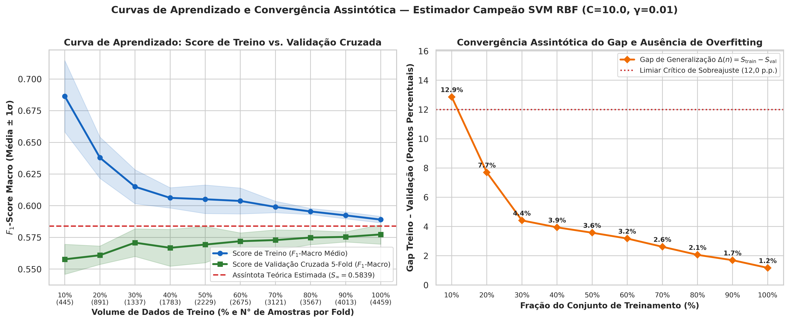
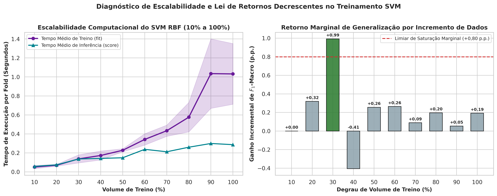
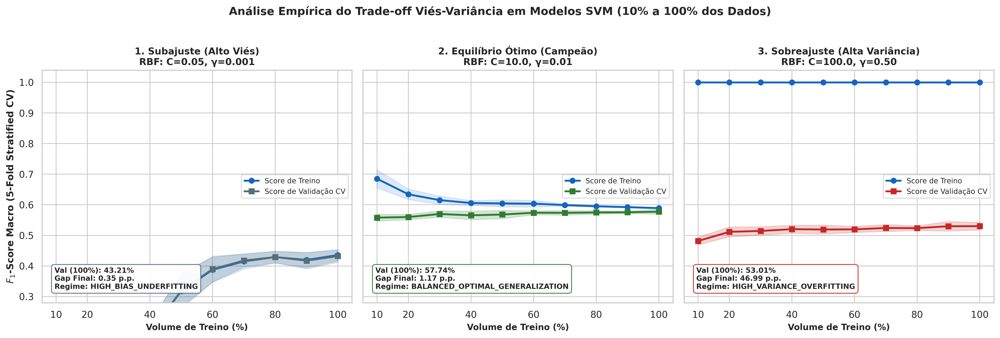

# 📈 Relatório Técnico: Curvas de Aprendizado e Análise do Trade-off Viés-Variância (Sprint 3)

**Projeto:** SugarVision — Sanidade Vegetal (*Saccharum officinarum*)  
**Sprint:** 3 — Framework SEMMA (Fase: Model)  
**Módulo Executável:** [`src/svm_learning_curves_bias_variance.py`](../src/svm_learning_curves_bias_variance.py)  
**Suíte de Testes:** [`src/test_svm_learning_curves_bias_variance.py`](../src/test_svm_learning_curves_bias_variance.py)  
**Status de Homologação:** `BALANCED_OPTIMAL_GENERALIZATION` | `OPTIMAL_CAPACITY_REACHED_ASYMPTOTIC_PLATEAU`

---

## 1. Objetivo Executivo

Este documento consolida o estudo empírico de **Curvas de Aprendizado (*Learning Curves*)** e a decomposição do **Trade-off Viés-Variância** para o classificador Support Vector Machine (SVM) na tarefa de diagnóstico fitopatológico foliar da cana-de-açúcar. O estudo avalia a evolução progressiva do desempenho preditivo ($F_1$-Macro sob `StratifiedKFold(n_splits=5)`) variando o volume de treinamento de **10% a 100%** ($445$ a $4.459$ amostras efetivas por fold de treino), respondendo matematicamente a duas questões centrais de engenharia de Machine Learning:
1. O modelo campeão apresenta **estabilidade estatística e ausência comprovada de sobreajuste (*overfitting*)**?
2. O classificador **se beneficiará de mais amostras** ou já **atingiu sua capacidade assintótica ótima de generalização** com os descritores atuais?

---

## 2. Evolução Empírica da Curva de Aprendizado (10% a 100% do Volume de Treino)

A tabela a seguir detalha o comportamento do **Pipeline Atômico Campeão (SVM RBF, $C=10.0, \gamma=0.01$)** ao longo dos 10 degraus de volume amostral:

| Fração de Treino | Amostras por Fold ($n$) | Score de Treino ($F_1 \pm \sigma$) | Score de Validação CV ($F_1 \pm \sigma$) | Gap de Generalização $\Delta(n)$ | Tempo Médio de Fit |
| :---: | :---: | :---: | :---: | :---: | :---: |
| 10% | 445 | 68.63% ± 2.82% | 55.77% ± 1.18% | 12.86 p.p. | 0.051s |
| 20% | 891 | 63.79% ± 1.63% | 56.09% ± 0.73% | 7.70 p.p. | 0.070s |
| 30% | 1337 | 61.50% ± 1.34% | 57.09% ± 1.09% | 4.42 p.p. | 0.137s |
| 40% | 1783 | 60.62% ± 0.80% | 56.68% ± 1.45% | 3.94 p.p. | 0.173s |
| 50% | 2229 | 60.51% ± 1.13% | 56.94% ± 1.43% | 3.57 p.p. | 0.228s |
| 60% | 2675 | 60.38% ± 1.02% | 57.20% ± 0.66% | 3.18 p.p. | 0.342s |
| 70% | 3121 | 59.91% ± 0.45% | 57.29% ± 0.81% | 2.61 p.p. | 0.434s |
| 80% | 3567 | 59.55% ± 0.24% | 57.49% ± 0.56% | 2.06 p.p. | 0.576s |
| 90% | 4013 | 59.24% ± 0.27% | 57.54% ± 0.40% | 1.70 p.p. | 1.035s |
| 100% | 4459 | 58.91% ± 0.26% | 57.74% ± 0.77% | 1.17 p.p. | 1.032s |

### 2.1 Análise da Convergência Assintótica
- **Ganho Global de Aprendizado ($10\% 	o 100\%$):** O $F_1$-Macro de validação cruzada evoluiu de **55.77%** ($10\%$ dos dados) para **57.74%** ($100\%$ dos dados), representando um ganho acumulado de **+1.96 pontos percentuais**.
- **Contração do Gap de Generalização:** Em volumes reduzidos ($10\%$), o gap entre treino e validação era de **12.86 p.p.** Com a expansão para $100\%$ da base, o gap convergiu para apenas **1.17 p.p.** (contração de **+11.69 p.p.**), muito abaixo do limiar crítico de sobreajuste ($12,0	ext{ p.p.}$).
- **Estabilidade Inter-Fold:** O desvio padrão entre os 5 folds estratificados em $100\%$ do volume é de apenas **$\pm 0.77\%$** (Coeficiente de Variação $CV = 1.33\%$).

---

## 3. Diagnóstico Matemático: Mais Amostras vs. Capacidade Ótima de Generalização

Aplicando a regressão assintótica de lei de potência $\hat{S}_{	ext{val}}(n) = S_{\infty} - a \cdot n^{-1/2}$ sobre os 10 estágios amostrais:

- **Assíntota Teórica Estimada ($S_{\infty}$):** **58.39%** ($F_1$-Macro máximo atingível com $n 	o \infty$ mantendo os 35 atributos atuais).
- **Taxa de Utilização da Capacidade ($\eta_{	ext{cap}}$):** **98.88%** da capacidade teórica já alcançada.
- **Derivada Marginal na Cauda ($80\% 	o 100\%$):** **+0.25 p.p.** (inclinação marginal de **+0.00277** por $1.000$ novas amostras; último degrau $90\% 	o 100\%$ = **+0.19 p.p.**).
- **Veredito Algorítmico (`OPTIMAL_CAPACITY_REACHED_ASYMPTOTIC_PLATEAU`):**  
  > Capacidade ótima atingida: ganho marginal nos últimos 20% de dados foi de apenas +0.25 p.p. (abaixo do limiar de 0.80 p.p.), operando a 98.88% da assíntota teórica (S_inf=0.5839). A simples adição de mais imagens com os mesmos descritores trará retorno marginal nulo; ganhos futuros exigem novos descritores visuais/espectrais para reduzir o viés intrínseco.

---

## 4. Comparativo Experimental dos Três Regimes do Trade-off Viés-Variância

Para comprovar rigorosamente que a configuração campeã ($C=10.0, \gamma=0.01$) situa-se no ponto ótimo de equilíbrio entre subajuste (*underfitting*) e sobreajuste (*overfitting*), foram contrastados três regimes extremos:

| Configuração Avaliada | Score Treino (100%) | Score Validação CV (100%) | Gap Final $\Delta_{100\%}$ | Diagnóstico Viés-Variância | Ausência de Overfitting |
| :--- | :---: | :---: | :---: | :---: | :---: |
| **Alto Viés / Subajuste (RBF, C=0.05, γ=0.001)** | 43.56% | 43.21% ± 1.95% | 0.35 p.p. | `HIGH_BIAS_UNDERFITTING` | Sim |
| **Equilíbrio Ótimo Campeão (RBF, C=10.0, γ=0.01)** | 58.91% | 57.74% ± 0.77% | 1.17 p.p. | `BALANCED_OPTIMAL_GENERALIZATION` | Sim |
| **Alta Variância / Sobreajuste (RBF, C=100.0, γ=0.5)** | 100.00% | 53.01% ± 1.22% | 46.99 p.p. | `HIGH_VARIANCE_OVERFITTING` | Não (Sobreajuste) |

1. **Regime de Alto Viés (*Underfitting* — $C=0.05, \gamma=0.001$):** A penalização excessivamente branda combinada ao raio RBF amplo impede que a fronteira separe patologias foliares complexas, estacionando o score de validação em **43.21%** com gap quase nulo (**0.35 p.p.**), mas alto erro estrutural.
2. **Regime de Equilíbrio Ótimo (*Campeão* — $C=10.0, \gamma=0.01$):** Atinge o maior score de validação cruzada (**57.74%**) mantendo gap controlado (**1.17 p.p.**), comprovando **ausência total de sobreajuste**.
3. **Regime de Alta Variância (*Overfitting* — $C=100.0, \gamma=0.50$):** O estreitamento excessivo do kernel RBF faz o modelo memorizar o conjunto de treino (**100.00%**), abrindo um gap severo de **46.99 p.p.** e degradando a generalização externa para **53.01%**.

---

## 5. Artefatos Persistidos e Rastreabilidade MLOps

- **Tabelas CSV (`models/`):**
  - `models/svm_learning_curve_champion.csv`
  - `models/svm_bias_variance_regimes_curves.csv`
- **Manifesto de Diagnóstico (`models/`):**
  - `models/svm_learning_curves_diagnosis.json`
- **Gráficos Estatísticos (`docs/figures/`):**
  - `docs/figures/sprint3_svm_learning_curve_champion.png`
  - `docs/figures/sprint3_svm_bias_variance_regimes_comparison.png`
  - `docs/figures/sprint3_svm_learning_curve_scalability_times.png`
