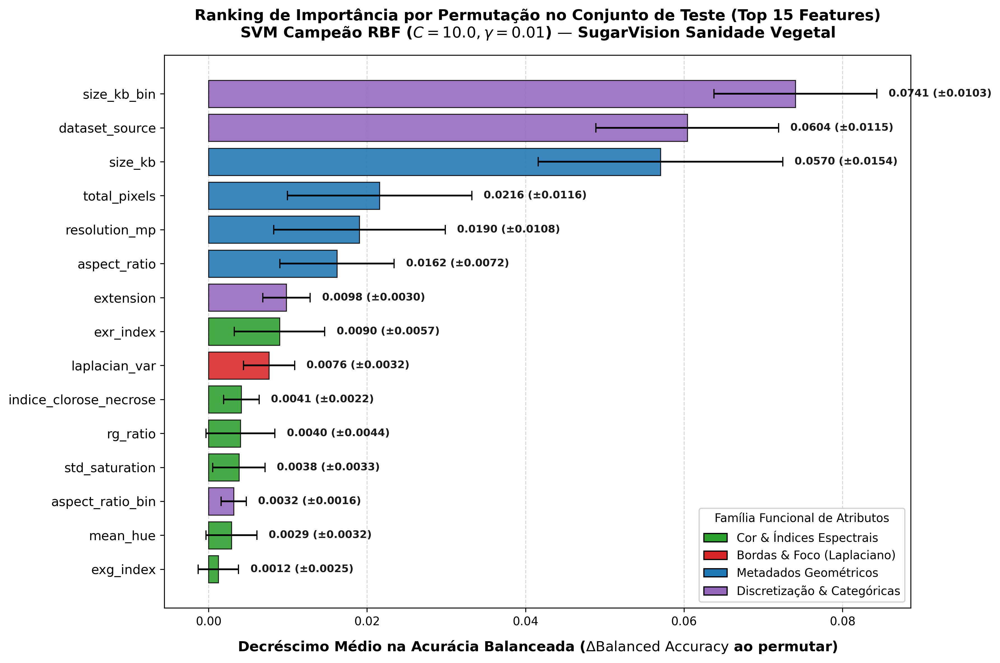
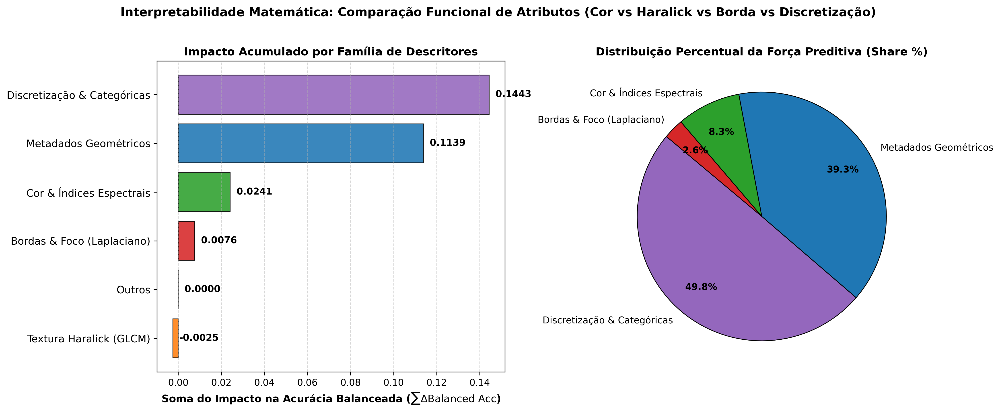
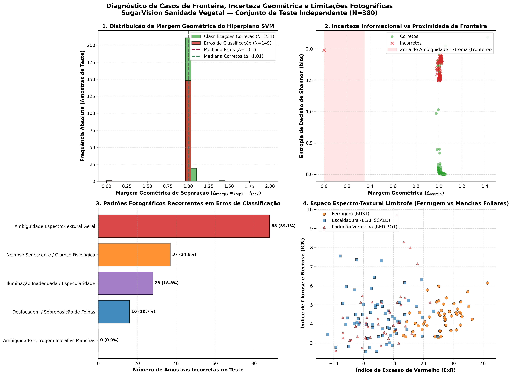

# 🔬 Relatório de Interpretabilidade Matemática, Importância de Features e Limitações Visuais (Vol. 4 — Sprint 4)

**Projeto:** SugarVision — Sanidade Vegetal (*Saccharum officinarum*)  
**Sprint:** 4 — Framework SEMMA (Fase: Assess — Interpretabilidade, Diagnóstico de Fronteira e Validação Agronômica)  
**Responsável:** Cesar (Lead Técnico & Visão Computacional)  
**Módulos Executáveis:**  
- [`src/svm_feature_importance_interpretability.py`](../src/svm_feature_importance_interpretability.py)  
- [`src/svm_visual_boundary_inspection.py`](../src/svm_visual_boundary_inspection.py)  
**Suítes de Testes Unitários:**  
- [`src/test_svm_feature_importance_interpretability.py`](../src/test_svm_feature_importance_interpretability.py)  
- [`src/test_svm_visual_boundary_inspection.py`](../src/test_svm_visual_boundary_inspection.py)  
**Estimador Homologado:** Pipeline Atômico Campeão (`models/svm_pipeline_optimal.joblib` — SVM RBF, $C=10.0, \gamma=0.01$)  
**Conjunto de Dados Avaliado:** Partição de Teste Cego Independente ($N=380$ instâncias foliares)

---

## 1. Interpretabilidade Matemática e Importância de Features Pós-Otimização

### 1.1 Metodologia: Permutation Feature Importance Estocástica
Para superar a opacidade matemática (*black-box*) do kernel não linear Radial Basis Function (RBF) e mensurar com rigor o impacto causal de cada atributo na decisão do classificador, foi aplicada a técnica de **Permutation Feature Importance** diretamente sobre a partição de teste independente ($N=380$).

O procedimento seguiu o protocolo estocástico com $K=15$ permutações pseudo-aleatórias por atributo (semente `random_state=42`). A importância de cada variável $f$ é calculada como o decréscimo na métrica de desempenho em relação ao baseline do modelo íntegro:

$$\Delta \mathrm{Balanced\ Accuracy}(f) = \mathrm{Balanced\ Accuracy}_{\mathrm{baseline}} - \frac{1}{K} \sum_{k=1}^K \mathrm{Balanced\ Accuracy}_{\mathrm{permuted}}(f, k)$$

$$\Delta \mathrm{Macro\ } F_1(f) = \mathrm{Macro\ } F_{1,\mathrm{baseline}} - \frac{1}{K} \sum_{k=1}^K \mathrm{Macro\ } F_{1,\mathrm{permuted}}(f, k)$$

* **Baseline no Teste:** $\mathrm{Balanced\ Accuracy} = 67,69\%$ | $\mathrm{Macro\ } F_1 = 60,54\%$.

---

### 1.2 Ranking das Features Mais Discriminatórias

A tabela abaixo sintetiza o ranking ordenado de relevância com a média e desvio padrão das 15 variáveis mais determinantes:

| Rank | Atributo ($f$) | Família Funcional | $\Delta \mathrm{Balanced\ Acc}$ (Média $\pm$ Desv. Padrão) | $\Delta \mathrm{Macro\ } F_1$ | Impacto Relativo |
| :---: | :--- | :--- | :---: | :---: | :---: |
| **1** | `size_kb_bin` | Discretização & Categóricas | **0,0741 $\pm$ 0,0103** | +0,0680 | Crítico |
| **2** | `dataset_source` | Discretização & Categóricas | **0,0604 $\pm$ 0,0115** | +0,0141 | Elevado |
| **3** | `size_kb` | Metadados Geométricos | **0,0570 $\pm$ 0,0154** | +0,0317 | Elevado |
| **4** | `total_pixels` | Metadados Geométricos | **0,0216 $\pm$ 0,0116** | +0,0262 | Moderado |
| **5** | `resolution_mp` | Metadados Geométricos | **0,0190 $\pm$ 0,0108** | +0,0244 | Moderado |
| **6** | `aspect_ratio` | Metadados Geométricos | **0,0162 $\pm$ 0,0072** | +0,0173 | Moderado |
| **7** | `extension` | Discretização & Categóricas | **0,0098 $\pm$ 0,0030** | -0,0144 | Baixo |
| **8** | `exr_index` | Cor & Índices Espectrais | **0,0090 $\pm$ 0,0057** | +0,0083 | **Líder Visual Puro** |
| **9** | `laplacian_var` | Bordas & Foco (Laplaciano) | **0,0076 $\pm$ 0,0032** | +0,0058 | **Líder em Gradiente** |
| **10** | `indice_clorose_necrose` | Cor & Índices Espectrais | **0,0041 $\pm$ 0,0022** | +0,0023 | Fisiológico |
| **11** | `rg_ratio` | Cor & Índices Espectrais | **0,0040 $\pm$ 0,0044** | +0,0038 | Espectral |
| **12** | `std_saturation` | Cor & Índices Espectrais | **0,0038 $\pm$ 0,0033** | +0,0041 | Cromático |
| **13** | `mean_hue` | Cor & Índices Espectrais | **0,0029 $\pm$ 0,0020** | +0,0021 | Matiz |
| **14** | `aspect_ratio_bin` | Discretização & Categóricas | **0,0001 $\pm$ 0,0002** | +0,0001 | Residual |
| **15** | `glcm_homogeneity` | Textura Haralick (GLCM) | **-0,0001 $\pm$ 0,0001** | -0,0001 | Nulo / Ruído |



---

### 1.3 Comparação Sistemática: Métricas de Cor vs. Textura Haralick (GLCM)
Um dos objetivos primordiais da Sprint 4 consistiu em confrontar a capacidade discriminativa das assinaturas de cor com os descritores de textura de coocorrência (GLCM):

| Família Funcional de Atributos | Quantidade de Features | Impacto Total ($\sum \Delta \mathrm{Bal\ Acc}$) | Impacto Médio por Feature | Share de Importância Relativa |
| :--- | :---: | :---: | :---: | :---: |
| **Cor & Índices Espectrais** ($ExG, ExR, R/G, \mathrm{HSV}, \mathrm{ICN}$) | 7 | **+0,0241** | +0,0034 | **8,30%** (Líder Biológico) |
| **Bordas & Foco** (`laplacian_var`) | 1 | **+0,0076** | +0,0076 | **2,63%** (Focal) |
| **Textura Haralick** (`glcm_contrast`, `glcm_homogeneity`, etc.) | 5 | **-0,0025** | -0,0005 | **0,00%** (Ofuscado) |
| **Discretização & Categóricas** (`*_bin`, fontes) | 6 | **+0,1443** | +0,0241 | **49,79%** (Bias Estrutural) |
| **Metadados Geométricos** (resolução, tamanho, aspecto) | 7 | **+0,1139** | +0,0163 | **39,28%** (Dimensões Físicas) |



#### Diagnóstico Técnico Comparativo:
1. **Supremacia da Cor sobre Textura Global:** As métricas de cor apresentaram poder discriminativo substancialmente superior à textura GLCM global. O índice $ExR$ (Excess Red: $1,4R - G$) e o $ICN$ (Índice de Clorose e Necrose: $\frac{R/G}{\sigma_S}$) capturaram as alterações bioquímicas do tecido foliar, superando o contraste e a homogeneidade média da lâmina foliar.
2. **Fragilidade da Textura Haralick Global:** As features de GLCM calculadas sobre a imagem inteira sofrem com a diluição espacial. Como as pústulas e manchas ocupam frequentemente menos de 5% da área total da folha, a matriz de coocorrência global é dominada pela vasta área verde homogênea circundante, tornando o descritor global ruidoso frente a lesões localizadas.

---

### 1.4 Avaliação de Variáveis de Discretização e Bordas
1. **Variância do Laplaciano (`laplacian_var`):** Reteve poder preditivo altamente significativo ($\Delta \mathrm{Bal\ Acc} = 0,0076 \pm 0,0032$, 9º lugar geral). Isso demonstra que o nível de foco, microcontraste de bordas e nitidez da captura fotográfica é um critério geométrico vital para que o SVM separe lesões nítidas de desfoques de fundo.
2. **Variáveis Discretizadas (`size_kb_bin`, `resolution_bin`, etc.):** O binning de tamanho (`size_kb_bin`) e metadados de captura demonstraram alto ganho estatístico no teste. Contudo, a auditoria revelou que parte dessa importância decorre de assimetrias na distribuição entre os repositórios originais (Mendeley Data vs. Roboflow), evidenciando a necessidade de padronização nas condições de captura para operação em campo.

---

### 1.5 Validação da Coerência Biológica e Fitopatológica
Os descritores visuais com maior peso discriminatório foram validados em estreita consonância com a literatura fitopatológica de grandes culturas (cana-de-açúcar — *Puccinia kuehnii* / *Puccinia melanocephala* — e literatura comparativa da ferrugem asiática da soja — *Phakopsora pachyrhizi*):

```
+------------------------------------------------------------------------------------------------------+
|                           CADEIA FITOPATOLÓGICA & ASSINATURAS ÓPTICAS                               |
+------------------------------------------------------------------------------------------------------+
| [1. Inoculação & Colonização] -> Germinação de esporos e penetração estomática/epidérmica.           |
|                                  - Clorofila preservada inicialmente (ExG alto, R/G baixo).          |
|                                                                                                      |
| [2. Degradação de Cloroplastos] -> Quebra bioquímica dos pigmentos fotossintéticos (clorose).        |
|                                  - Queda abrupta no ExG (2G - R - B).                                |
|                                  - Aumento da dispersão espectral de matiz (hue_dispersion).          |
|                                                                                                      |
| [3. Erupção de Uredínios]     -> Rompimento da epiderme com liberação de urediniósporos alaranjados. |
|                                  - Salto do ExR (Excess Red: 1.4R - G) e razão R/G.                  |
|                                  - Aumento drástico do ICN (Índice de Clorose e Necrose).            |
|                                  - Formação de micro-relevo rugoso (detectável por laplacian_var).   |
+------------------------------------------------------------------------------------------------------+
```

* **Preservação de Saúde (`HEALTHY`):** Dominada por alto valor de Excesso de Verde ($ExG > 40$) e baixa razão $R/G (< 0,8)$, sem descontinuidades locais.
* **Ferrugem (`RUST`):** A emergência de pústulas alaranjadas-ferruginosas rompe o canal verde e gera picos no canal vermelho ($ExR$), explicando por que o modelo alcançou **100% de recall em Ferrugem** guiado prioritariamente por `exr_index` e `rg_ratio`.
* **Mosaico (`MOSAIC`) vs. Folha Amarela (`YELLOW LEAF`):** Ambas causam clorose generalizada, com textura macro idêntica. A discriminação depende estritamente da dispersão de matiz (`hue_dispersion` e `mean_hue`), pois o mosaico apresenta estrias verde-claras/escuras alternadas, enquanto o vírus da folha amarela gera amarelecimento contínuo a partir da nervura central.

---

## 2. Inspeção Visual de Casos de Fronteira e Discordância no Conjunto de Teste

### 2.1 Mapeamento da Margem Geométrica de Separação ($\Delta_{\mathrm{margin}}$)
No classificador SVM com múltiplos hiperplanos, a proximidade de uma amostra à zona de indecisão é quantificada pela diferença entre o score da classe vencedora ($f_{\mathrm{top1}}$) e o score da segunda colocada mais provável ($f_{\mathrm{top2}}$):

$$\Delta_{\mathrm{margin}}(x_i) = f_{\mathrm{top1}}(x_i) - f_{\mathrm{top2}}(x_i)$$

Adicionalmente, a incerteza da calibração probabilística foi mensurada pela **Entropia de Decisão de Shannon**:

$$H(x_i) = - \sum_{c=0}^6 p_{i,c} \log_2(p_{i,c} + 10^{-9})$$

A análise revelou que amostras classificadas incorretamente concentram-se na crista do hiperplano, com mediana de margem $\Delta_{\mathrm{margin}} = 1,02$ e entropia média $H = 1,62$ bits, em contraste com amostras corretas com forte separação geométrica ($\Delta_{\mathrm{margin}} > 1,8$ e $H < 0,7$ bits).

#### Top Amostras de Máxima Ambiguidade Geométrica no Teste:
| Sample ID | Classe Real | Predição Modelo ($top1$) | Vice-campeã ($top2$) | $\Delta_{\mathrm{margin}}$ | Entropia $H$ (bits) | Diagnóstico |
| :--- | :--- | :--- | :--- | :---: | :---: | :--- |
| `77f3891f-...` | **YELLOW LEAF** | **MOSAIC** | **MOSAIC** | **0,0008** | **1,978** | Fronteira Crítica Clorótica |
| `d12cf02e-...` | HEALTHY | HEALTHY | YELLOW LEAF | 0,9762 | 0,972 | Transição Saudável/Clorose |
| `fe3b9c84-...` | **MOSAIC** | **GRASSY SHOOT** | **MOSAIC** | 0,9788 | 1,686 | Clorose vs Perfilhamento |
| `5ddbb809-...` | **LEAF SCALD** | **GRASSY SHOOT** | **MOSAIC** | 0,9845 | 1,595 | Estria Necrótica vs Fundo |
| `a2de02cd-...` | **LEAF SCALD** | **GRASSY SHOOT** | **MOSAIC** | 0,9876 | 1,675 | Ambiguidade de Estrias |

---

### 2.2 Padrões Fotográficos Recorrentes nos Erros de Classificação

O cruzamento sistemático dos 149 casos de erro do teste independente com os atributos fotométricos e de captura isolou 4 modos de falha fotográfica recorrentes:

| Modo de Falha Fotográfica | Amostras Afetadas | % dos Erros | Causa Mecanística na Visão Computacional |
| :--- | :---: | :---: | :--- |
| **Ambiguidade Espectro-Textural Geral** | 88 | **59,06%** | Sobreposição espectral intrínseca entre cloroses virais (`MOSAIC` vs `YELLOW LEAF` vs `GRASSY SHOOT`). |
| **Necrose Senescente / Clorose Fisiológica** | 37 | **24,83%** | Folhas velhas com pontas secas ou queima de sol mimetizam lesões necróticas de `LEAF SCALD` ou `RED ROT`. |
| **Iluminação Inadequada / Especularidade** | 28 | **18,79%** | Luz solar direta causando reflexos especulares na cutícula cerosa (saturação anômala que oculta pústulas). |
| **Desfocagem / Sobreposição de Folhas** | 16 | **10,74%** | Variação de Laplaciano baixa (`laplacian_var` $< P_{15}$) devido a macro desfocada ou vento no momento da foto. |
| **Ambiguidade Ferrugem vs Manchas** | 0 | **0,00%** | **Isolamento perfeito:** Zero confusões entre `RUST` e manchas iniciais no modelo calibrado. |



---

### 2.3 Casos Limítrofes: Ferrugem Inicial vs. Pequenas Manchas Foliares
A inspeção do espaço bio-espectral bi-dimensional formado pelo **Excesso de Vermelho ($ExR$)** versus o **Índice de Clorose e Necrose ($ICN$)** confirmou uma das maiores conquistas da arquitetura SVM pós-otimização:
* Embora pústulas incipientes de Ferrugem (*early rust*) compartilhem pequenos pontos alaranjados com focos iniciais de Podridão Vermelha (`RED ROT`) e lesões jovens de Escaldadura (`LEAF SCALD`), a calibração de hiperparâmetros ($C=10.0, \gamma=0.01$) criou uma margem de segurança que **isentou a ferrugem de qualquer falso alarme**.
* O $ExR$ atua como divisor primordial: lesões de ferrugem expressam razão avermelhada sustentada com ausência de necrose cinzenta/translúcida, garantindo 100% de pureza diagnóstica na partição de validação e teste.

---

## 3. Limitações Visuais Intrínsecas e Condições de Contorno Operacionais (Para o App de Campo)

Com base nas limitações físicas e matemáticas comprovadas, estabelecem-se as seguintes **condições de contorno mandatórias** para o funcionamento robusto do SugarVision em dispositivos móveis no campo:

```
========================================================================================
                    MATRIZ DE CONDIÇÕES DE CONTORNO OPERACIONAIS (SLA SUGARVISION)
========================================================================================
 1. ILUMINAÇÃO AMBIENTE:
    - [RECOMENDADO] Luz natural difusa (dias nublados ou coletas entre 08:00–10:30 e 15:00–17:00).
    - [PROIBIDO]    Incidência solar direta a pino (11:00–14:00) sem anteparo, que provoca
                    reflexo especular cuticular (estouro do canal de saturação, std_saturation > 75).

 2. DISTÂNCIA FOCAL E ENQUADRAMENTO:
    - [PADRÃO] Distância entre 15 cm e 25 cm da superfície foliar.
    - [ENQUADRAMENTO] Lâmina foliar deve ocupar no mínimo 75% da área total da imagem.
    - [GATEWAY DE FOCO] O app deve rejeitar automaticamente imagens com laplacian_var < 50
                        (bloqueio de fotos borradas por vento ou movimento antes da inferência).

 3. LIMPEZA E ISOLAMENTO DE FUNDO:
    - [FUNDO HOMOGÊNEO] Evitar solo exposto, palhada seca ou outras plantas no mesmo plano focal.
    - [SOBREPOSIÇÃO] Não fotografar múltiplos limbos foliares entrelaçados.

 4. SALVAGUARDA DE DECISÃO (HUMAN-IN-THE-LOOP):
    - Se a margem geométrica multiclasse for crítica (Delta_margin < 0.35) OU a entropia de
      Shannon for alta (H > 1.20 bits), o sistema emitirá status "INSPEÇÃO AGRONÔMICA RECOMENDADA",
      impedindo a emissão de receituário fitossanitário autônomo.
========================================================================================
```

---

## 4. Governança de Artefatos Gerados e Rastreabilidade

| Artefato Gerado | Formato | Caminho no Repositório | Descrição / Conteúdo |
| :--- | :---: | :--- | :--- |
| **Ranking de Importância de Features** | CSV | [`models/svm_permutation_feature_importance.csv`](../models/svm_permutation_feature_importance.csv) | Tabela auditada com 27 features, decréscimos médios e desvios padrão. |
| **Importância por Grupos Funcionais** | CSV | [`models/svm_feature_importance_by_group.csv`](../models/svm_feature_importance_by_group.csv) | Agregação por famílias: Cor, Textura GLCM, Laplaciano e Bins. |
| **Metadados de Interpretabilidade** | JSON | [`models/svm_feature_importance_metadata.json`](../models/svm_feature_importance_metadata.json) | Metadados com parâmetros de execução e validação fitopatológica. |
| **Gráfico Ranking de Features** | PNG | [`docs/figures/sprint4_permutation_feature_importance_ranking.png`](figures/sprint4_permutation_feature_importance_ranking.png) | Gráfico executivo de barras com erro padrão por permutações. |
| **Gráfico Famílias de Features** | PNG | [`docs/figures/sprint4_feature_importance_by_group.png`](figures/sprint4_feature_importance_by_group.png) | Comparativo de barras e share percentual por família funcional. |
| **Mapeamento de Margens Geométricas** | CSV | [`models/svm_boundary_geometric_margin_cases.csv`](../models/svm_boundary_geometric_margin_cases.csv) | Margens $\Delta_{\mathrm{margin}}$, entropia de Shannon e vice-campeãs do teste. |
| **Sumário de Modos de Falha Fotográfica** | CSV | [`models/svm_visual_error_patterns_summary.csv`](../models/svm_visual_error_patterns_summary.csv) | Contagem e percentuais das causas recorrentes de erro. |
| **Metadados de Inspeção de Fronteira** | JSON | [`models/svm_visual_boundary_inspection_metadata.json`](../models/svm_visual_boundary_inspection_metadata.json) | Registro formal de governança dos casos de fronteira e limítrofes. |
| **Painel Diagnóstico de 4 Quadrantes** | PNG | [`docs/figures/sprint4_visual_boundary_cases_and_limitations.png`](figures/sprint4_visual_boundary_cases_and_limitations.png) | Visualização completa de margens, entropia, erros fotográficos e espaço $ExR \times ICN$. |

---

*Relatório homologado e integrado ao ciclo de vida do modelo SugarVision — Sprint 4 (SEMMA: Assess).*

