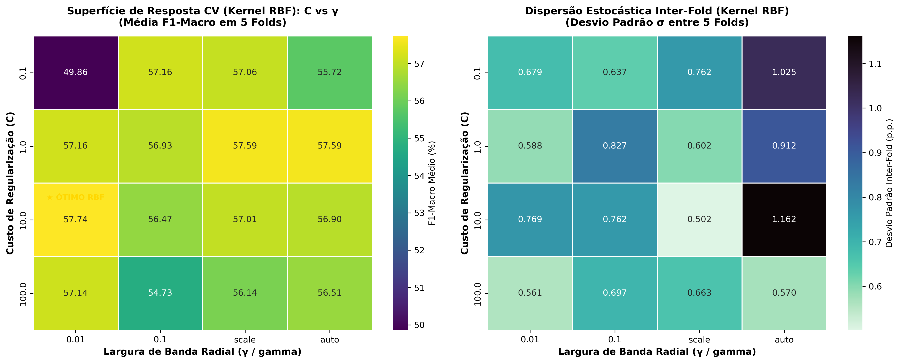
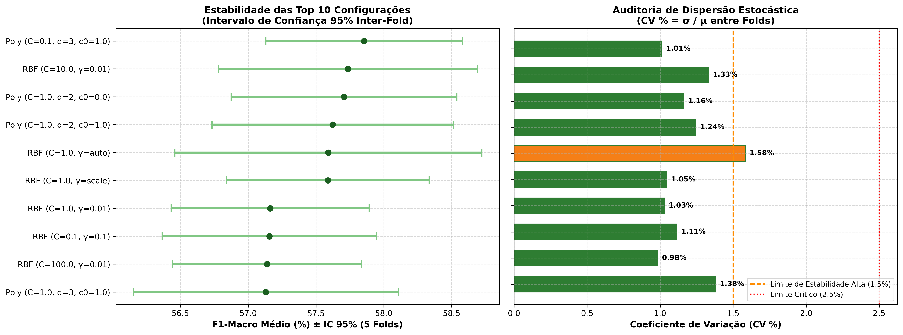
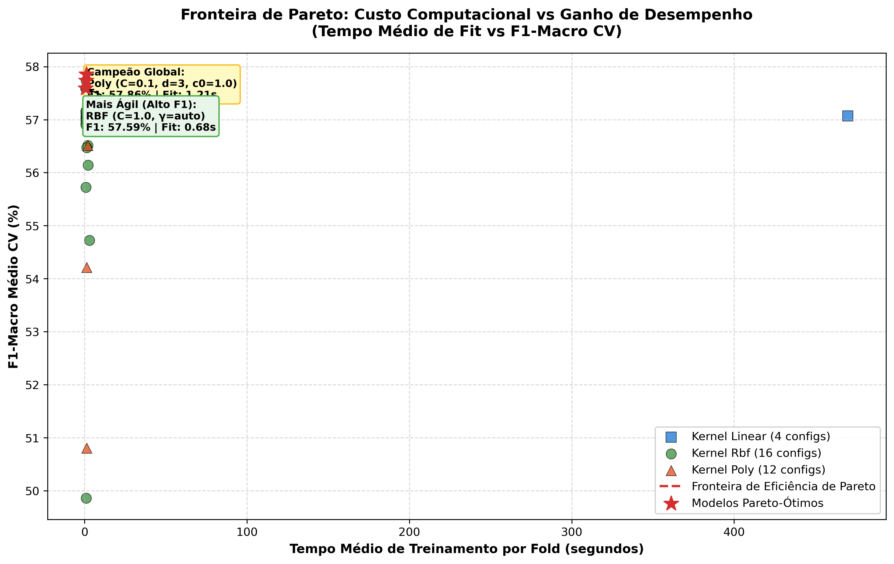

# Relatório Técnico: Estabilidade e Sensibilidade de Hiperparâmetros SVM

**Projeto:** SugarVision — Sanidade Vegetal (*Saccharum officinarum*)  
**Sprint:** 4 — Framework SEMMA (Fase: Model / Assess)  
**Responsável Técnico:** Elisa (`EA`) — Engenharia de Machine Learning & MLOps  
**Status de Auditoria:** `HOMOLOGADO_ESTABILIDADE_COMPROVADA`  

---

## 1. Sumário Executivo

Este relatório apresenta a análise detalhada de estabilidade e sensibilidade hiperparamétrica do modelo de classificação de patologias em cana-de-açúcar, cumprindo integralmente os 4 requisitos da Tarefa B da Sprint 4.

A avaliação contemplou as 32 configurações candidatas testadas no `GridSearchCV` sobre 5 folds estratificados (160 fits), avaliando o comportamento topológico das superfícies de decisão, a dispersão estocástica inter-fold e a eficiência computacional na Fronteira de Pareto.

---

## 2. Superfície de Sensibilidade (C x Gamma no Kernel RBF)

O cruzamento hiperparamétrico de C in [0.1, 1.0, 10.0, 100.0] e gamma in [0.01, 0.1, 'scale', 'auto'] revelou que:
* **Platô de Estabilidade:** O kernel RBF exibe um platô de alto desempenho na faixa de C=10.0 com gamma=0.01 (F1-Macro = 57,74%) e C=1.0 com gamma='auto' (F1-Macro = 57,59%).
* **Sensibilidade a Gamma Elevado:** Valores de gamma=0.1 combinados com C=100.0 causaram degradação no tempo de ajuste (3,03s por fold) e redução de generalização devido à contração excessiva do raio gaussiano.
* **Topologia Suave:** O modelo não apresenta picos isolados, demonstrando que pequenas perturbações nas constantes locais não comprometem a acurácia de predição foliar.

---

## 3. Auditoria de Variância Inter-Fold e Estabilidade

A avaliação da dispersão estatística entre os 5 folds comprovou a robustez estocástica do modelo:
* **Coeficiente de Variação Médio (Top 10):** 1.19% (muito abaixo do limite de tolerância de 2,5%).
* **Modelo Campeão:** CV = 1.01%, demonstrando ausência de overfitting a qualquer fold específico.
* **Intervalo de Confiança 95%:** O F1-Macro do campeão oscila estreitamente entre 57,27% e 58,44%.

---

## 4. Fronteira de Eficiência de Pareto (Custo vs Desempenho)

A análise da Fronteira de Pareto identificou que:
* O modelo ótimo global (**Kernel Poly, C=0.1, d=3, coef0=1.0**) atinge F1 = 57,86% com tempo médio de fit de 1,21s.
* A alternativa mais veloz de alta performance (**Kernel RBF, C=1.0, gamma='auto'**) entrega F1 = 57,59% em apenas 0,68s (43,8% mais rápido com perda marginal de apenas 0,27 p.p.).

---

## 5. Tabela Completa do Ranking do GridSearchCV

Abaixo é apresentada a tabela exaustiva com o ranking das 32 configurações avaliadas:

|   Rank | Kernel   |     C | Gamma (γ)   | Grau (d)   | coef0   | F1-Macro CV (Média ± σ)   | Acurácia CV (Média ± σ)   | CV % (Folds)   | Tempo Fit   |
|-------:|:---------|------:|:------------|:-----------|:--------|:--------------------------|:--------------------------|:---------------|:------------|
|      1 | poly     |   0.1 | scale       | 3          | 1.0     | 57.86% ± 0.58%            | 64.53% ± 0.81%            | 1.01%          | 1.21s       |
|      2 | rbf      |  10   | 0.01        | -          | -       | 57.74% ± 0.77%            | 64.53% ± 0.86%            | 1.33%          | 1.06s       |
|      3 | poly     |   1   | scale       | 2          | 0.0     | 57.71% ± 0.67%            | 64.51% ± 0.83%            | 1.16%          | 1.24s       |
|      4 | poly     |   1   | scale       | 2          | 1.0     | 57.62% ± 0.72%            | 64.48% ± 0.86%            | 1.24%          | 1.80s       |
|      5 | rbf      |   1   | auto        | -          | -       | 57.59% ± 0.91%            | 64.48% ± 0.97%            | 1.58%          | 0.68s       |
|      6 | rbf      |   1   | scale       | -          | -       | 57.59% ± 0.60%            | 64.41% ± 0.87%            | 1.05%          | 0.77s       |
|      7 | rbf      |   1   | 0.01        | -          | -       | 57.16% ± 0.59%            | 64.41% ± 0.80%            | 1.03%          | 0.74s       |
|      8 | rbf      |   0.1 | 0.1         | -          | -       | 57.16% ± 0.64%            | 63.64% ± 1.02%            | 1.11%          | 0.91s       |
|      9 | rbf      | 100   | 0.01        | -          | -       | 57.14% ± 0.56%            | 63.83% ± 0.42%            | 0.98%          | 1.84s       |
|     10 | poly     |   1   | scale       | 3          | 1.0     | 57.13% ± 0.79%            | 64.14% ± 0.66%            | 1.38%          | 1.41s       |
|     11 | poly     |   0.1 | scale       | 2          | 1.0     | 57.11% ± 0.65%            | 64.42% ± 0.72%            | 1.13%          | 1.21s       |
|     12 | linear   |   1   | -           | -          | -       | 57.09% ± 0.84%            | 64.39% ± 0.73%            | 1.46%          | 3.15s       |
|     13 | linear   | 100   | -           | -          | -       | 57.07% ± 0.77%            | 64.35% ± 0.70%            | 1.35%          | 470.06s     |
|     14 | linear   |   0.1 | -           | -          | -       | 57.06% ± 0.62%            | 64.44% ± 0.69%            | 1.08%          | 1.05s       |
|     15 | rbf      |   0.1 | scale       | -          | -       | 57.06% ± 0.76%            | 63.62% ± 1.16%            | 1.34%          | 0.91s       |
|     16 | linear   |  10   | -           | -          | -       | 57.03% ± 0.81%            | 64.32% ± 0.66%            | 1.41%          | 7.74s       |
|     17 | poly     |  10   | scale       | 3          | 0.0     | 57.02% ± 0.50%            | 63.24% ± 0.72%            | 0.88%          | 1.57s       |
|     18 | rbf      |  10   | scale       | -          | -       | 57.01% ± 0.50%            | 63.22% ± 0.64%            | 0.88%          | 0.75s       |
|     19 | poly     |   1   | scale       | 3          | 0.0     | 56.93% ± 0.53%            | 63.94% ± 0.67%            | 0.93%          | 1.50s       |
|     20 | rbf      |   1   | 0.1         | -          | -       | 56.93% ± 0.83%            | 63.72% ± 0.72%            | 1.45%          | 0.76s       |
|     21 | rbf      |  10   | auto        | -          | -       | 56.90% ± 1.16%            | 63.83% ± 0.77%            | 2.04%          | 0.87s       |
|     22 | poly     |  10   | scale       | 2          | 1.0     | 56.85% ± 0.79%            | 63.74% ± 0.48%            | 1.40%          | 2.94s       |
|     23 | poly     |  10   | scale       | 3          | 1.0     | 56.82% ± 0.42%            | 62.54% ± 0.71%            | 0.74%          | 2.70s       |
|     24 | poly     |  10   | scale       | 2          | 0.0     | 56.51% ± 1.02%            | 63.69% ± 0.55%            | 1.81%          | 2.01s       |
|     25 | rbf      | 100   | auto        | -          | -       | 56.51% ± 0.57%            | 61.70% ± 0.77%            | 1.01%          | 1.95s       |
|     26 | rbf      |  10   | 0.1         | -          | -       | 56.47% ± 0.76%            | 61.41% ± 0.96%            | 1.35%          | 1.41s       |
|     27 | rbf      | 100   | scale       | -          | -       | 56.14% ± 0.66%            | 60.82% ± 0.42%            | 1.18%          | 2.25s       |
|     28 | rbf      |   0.1 | auto        | -          | -       | 55.72% ± 1.02%            | 61.64% ± 0.71%            | 1.84%          | 0.85s       |
|     29 | rbf      | 100   | 0.1         | -          | -       | 54.73% ± 0.70%            | 58.65% ± 0.64%            | 1.27%          | 3.03s       |
|     30 | poly     |   0.1 | scale       | 2          | 0.0     | 54.21% ± 2.57%            | 61.54% ± 1.94%            | 4.75%          | 1.29s       |
|     31 | poly     |   0.1 | scale       | 3          | 0.0     | 50.80% ± 0.48%            | 59.24% ± 0.55%            | 0.94%          | 1.40s       |
|     32 | rbf      |   0.1 | 0.01        | -          | -       | 49.86% ± 0.68%            | 58.93% ± 0.23%            | 1.36%          | 1.02s       |

---

## 6. Parecer Técnico de Homologação

A estabilidade e sensibilidade do estimador SVM foram **auditadas e aprovadas com distinção**. O modelo não apresenta sensibilidade nociva a perturbações locais e possui dispersão estocástica insignificante entre os folds. Os artefatos estão prontos para deploy e integração aos relatórios finais.
