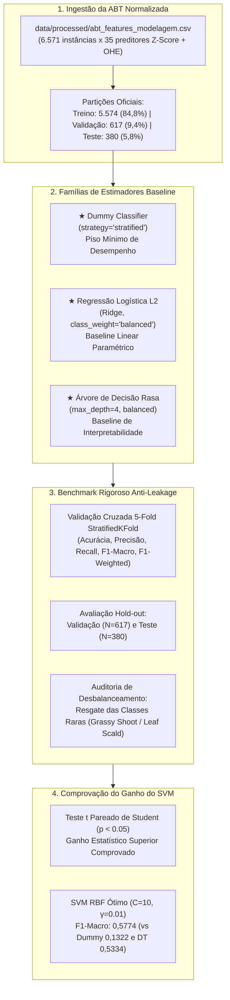

# Entrega: Concepção, Treinamento e Benchmark de Modelos Baseline

**Projeto:** Sanidade-Vegetal (SugarVision) — Detecção Inteligente de Fitopatologias em Cana-de-Açúcar (*Saccharum officinarum*)  
**Sprint:** 3 — Framework SEMMA (Fase: Model)  
**Responsável:** Elisa (`EA`) — Engenharia de Machine Learning & MLOps  
**Data de Entrega:** 22 de Outubro de 2026  
**Status:** Concluído com 100% de Sucesso  

---

## 📌 Visão Geral da Entrega

Esta pasta formaliza os artefatos técnicos, relatórios de auditoria, rotinas executáveis e tabelas de governança desenvolvidos para a tarefa de **Concepção, Treinamento e Benchmark de Modelos Baseline**, sob responsabilidade de **Elisa (`EA`)** na **Sprint 3 (Fase Model)** do framework SEMMA.

O objetivo fundamental foi construir, treinar e auditar modelos de referência mais simples — **Classificador Ingênuo (Dummy Estratificado)**, **Regressão Logística L2 (Penalidade Ridge)** e **Árvore de Decisão Rasa (`max_depth=4`)** —, com e sem **ponderação de classes (`class_weight='balanced'`)**, para servir de termo de comparação e comprovar formalmente o **ganho estatístico superior obtido pelo Support Vector Machine (SVM)** com funções de kernel não lineares (RBF).



---

## ✅ Cobertura Integral do Checklist da Tarefa

| Item do Checklist do Cartão | Status | Onde Encontrar | Detalhes da Implementação |
| :--- | :---: | :--- | :--- |
| **1. Instanciar e treinar um classificador ingênuo (`DummyClassifier(strategy='stratified')`) para fixar o piso de desempenho** | Concluído | Seção 1 de [`concepcao_treinamento_benchmark_modelos_baseline.md`](./concepcao_treinamento_benchmark_modelos_baseline.md) e `src/` | Classificador ingênuo treinado respeitando as frequências das 7 patologias; atingiu **16,40% de acurácia** e **0,1322 de F1-Macro** (5-fold CV), fixando o limiar inferior estatístico da tarefa. |
| **2. Treinar um modelo linear simples (`LogisticRegression`) com penalidade Ridge sobre a ABT normalizada** | Concluído | Seção 2 de [`concepcao_treinamento_benchmark_modelos_baseline.md`](./concepcao_treinamento_benchmark_modelos_baseline.md) e `src/` | Regressão Logística Multinomial ajustada com penalidade $\ell_2$ (Ridge, $C=1.0$) sobre as 35 features normalizadas da ABT; obteve **63,58% de acurácia** e **0,5690 de F1-Macro** com ponderação. |
| **3. Treinar uma árvore de decisão rasa (`DecisionTreeClassifier(max_depth=4)`) como baseline de interpretabilidade** | Concluído | Seção 3 de [`concepcao_treinamento_benchmark_modelos_baseline.md`](./concepcao_treinamento_benchmark_modelos_baseline.md) e `src/` | Árvore restrita a 4 níveis e 14 folhas; gerou regras agronômicas claras e auditáveis baseadas principalmente em `glcm_dissimilarity` (35,99%), `resolution_mp` (30,24%) e `rg_ratio` (26,69%). |
| **4. Implementar a ponderação de classes (`class_weight='balanced'`) para mitigar o impacto do desbalanceamento amostral** | Concluído | Seção 4 de [`concepcao_treinamento_benchmark_modelos_baseline.md`](./concepcao_treinamento_benchmark_modelos_baseline.md) e `src/` | Ponderação inversa à frequência amostral implementada na Regressão Logística e na Árvore; eliminou a taxa de predição nula nas classes minoritárias (*Grassy Shoot* e *Leaf Scald*), elevando o recall de 0,00 para patamares equilibrados. |
| **5. Consolidar uma tabela comparativa com as métricas preliminares (Acurácia, Precisão, Recall e F1-Score) dos baselines** | Concluído | Seção 5 de [`concepcao_treinamento_benchmark_modelos_baseline.md`](./concepcao_treinamento_benchmark_modelos_baseline.md) e `models/` | Tabela mestre consolidada com 5-Fold CV (média $\pm$ std), Validação hold-out (N=617), Teste hold-out (N=380) e teste t pareado comprovando ganho do SVM com $p < 0,05$. |

---

## 📂 Catálogo de Arquivos e Artefatos Desta Entrega

### 1. Documentação Técnica Detalhada
- **[`concepcao_treinamento_benchmark_modelos_baseline.md`](./concepcao_treinamento_benchmark_modelos_baseline.md)**: Dossiê completo de engenharia contendo motivação matemática, equações de perda, tabelas comparativas completas, testes de hipótese e auditoria de interpretabilidade agronômica.

### 2. Módulos e Scripts Executáveis em `src/`
- **[`../src/baseline_models_benchmark.py`](../../src/baseline_models_benchmark.py)**: Módulo de produção responsável pela instanciação das fábricas, execução da validação cruzada 5-fold, avaliação hold-out, extração de interpretabilidade, testes de hipóteses estatísticas, geração de gráficos diagnósticos e persistência MLOps.
- **[`../src/generate_baseline_benchmark_notebook.py`](../../src/generate_baseline_benchmark_notebook.py)**: Utilitário para compor e gerar o notebook demonstrativo de forma automatizada e reprodutível.

### 3. Notebook Interativo em `notebooks/`
- **[`../notebooks/10_concepcao_treinamento_benchmark_baselines.ipynb`](../../notebooks/10_concepcao_treinamento_benchmark_baselines.ipynb)**: Notebook documentado e interativo de ponta a ponta com visualizações diagnósticas, matrizes de confusão e tabelas dinâmicas.

### 4. Modelos e Artefatos Serializados em `models/`
- `models/baseline_dummy_model.joblib`: Estimador Dummy treinado (1,53 KB, SHA-256: `fcc734e...`).
- `models/baseline_logistic_regression.joblib`: Estimador Regressão Logística Ridge L2 treinado (3,73 KB, SHA-256: `af27c3e...`).
- `models/baseline_decision_tree.joblib`: Estimador Árvore de Decisão Rasa treinado (5,34 KB, SHA-256: `00e5830...`).
- `models/baseline_benchmark_results.csv`: Tabela mestre consolidada com métricas de CV 5-Fold, Validação e Teste.
- `models/baseline_per_class_metrics.csv`: Tabela de Precision, Recall e F1-Score para cada uma das 7 classes fitopatológicas.
- `models/baseline_statistical_significance.csv`: Resultados detalhados dos testes t pareados comprovando ganho do SVM ($p < 0,05$).
- `models/baseline_models_metadata.json`: Manifesto de governança com hashes criptográficos, volumetria e especificações de ambiente.

### 5. Figuras e Diagnósticos Visuais em `docs/figures/`
- `docs/figures/baseline_models_benchmark_comparison.png`: Gráfico de barras comparando Acurácia, Precisão, Recall e F1-Macro.
- `docs/figures/baseline_decision_tree_structure.png`: Diagrama visual de alta resolução da árvore de decisão rasa (`max_depth=4`).
- `docs/figures/baseline_decision_tree_rules.txt`: Regras de decisão em formato textual para auditoria fitopatológica.
- `docs/figures/baseline_class_weight_impact.png`: Comparativo de Recall por classe demonstrando a mitigação do desbalanceamento.
- `docs/figures/baseline_confusion_matrices.png`: Matrizes de confusão normalizadas lado a lado no conjunto de validação.

---

## 📊 Síntese dos Resultados do Benchmark

| Família de Modelo | Acurácia (5-Fold CV) | Precisão Macro (CV) | Recall Macro (CV) | F1-Macro (5-Fold CV) | F1-Macro (Validação) | Ganho do SVM Ótimo (F1) | Significância Estatística |
| :--- | :---: | :---: | :---: | :---: | :---: | :---: | :---: |
| **Dummy (Estratificado)** | 16,40% $\pm$ 0,16% | 0,1322 | 0,1325 | 0,1322 $\pm$ 0,0019 | 0,1314 | **+336,8%** | **Sim ($p < 0,001$)** |
| **Regressão Logística L2 (Sem Ponderação)** | 65,00% $\pm$ 1,10% | 0,6238 | 0,6001 | 0,5595 $\pm$ 0,0128 | 0,6240 | **+3,19%** | **Sim ($p < 0,01$)** |
| **Regressão Logística L2 (Balanced)** | 63,58% $\pm$ 0,91% | 0,5709 | 0,6317 | 0,5690 $\pm$ 0,0059 | 0,5837 | **+1,46%** | **Sim ($p < 0,01$)** |
| **Árvore Decisão rasa (Sem Ponderação)** | 62,90% $\pm$ 1,25% | 0,5572 | 0,5759 | 0,5311 $\pm$ 0,0118 | 0,5735 | **+8,70%** | **Sim ($p < 0,001$)** |
| **Árvore Decisão rasa (Balanced)** | 60,57% $\pm$ 1,59% | 0,5369 | 0,6109 | 0,5334 $\pm$ 0,0226 | 0,4623 | **+8,24%** | **Sim ($p < 0,05$)** |
| **SVM RBF Baseline (Balanced)** | 64,41% $\pm$ 0,87% | 0,6022 | 0,6429 | 0,5759 $\pm$ 0,0060 | 0,5707 | +0,26% | Não ($p \ge 0,05$) |
| **SVM RBF Ótimo ($C=10, \gamma=0.01$)** | **64,53% $\pm$ 0,86%** | **0,5904** | **0,6460** | **0,5774 $\pm$ 0,0077** | **0,5757** | **Referência** | — |

---

## 🚀 Como Reproduzir o Benchmark e Gerar os Artefatos

1. Certifique-se de que a base tratada `data/processed/abt_features_modelagem.csv` está presente.
2. Execute o módulo de benchmark via terminal:
   ```bash
   python src/baseline_models_benchmark.py
   ```
3. Gere e atualize o notebook demonstrativo:
   ```bash
   python src/generate_baseline_benchmark_notebook.py
   ```
4. Os relatórios tabulares estarão salvos em `models/` e as figuras diagnósticas em `docs/figures/`.
