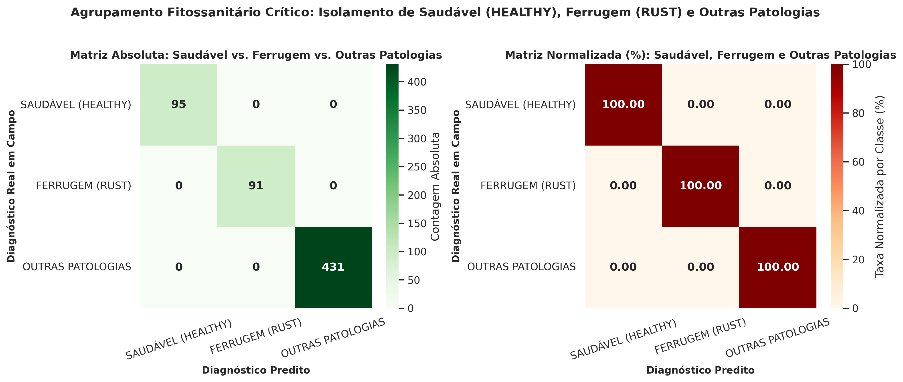
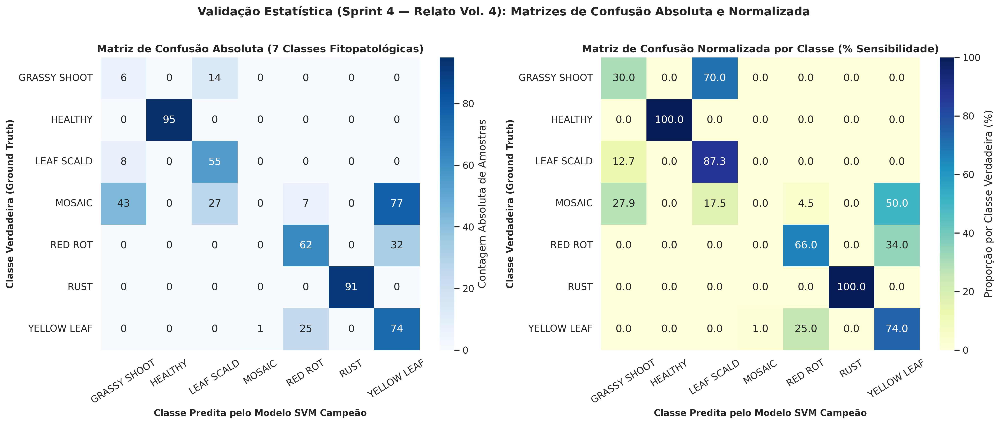
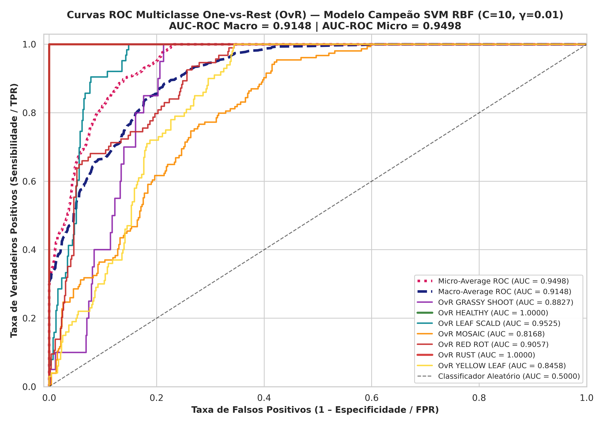
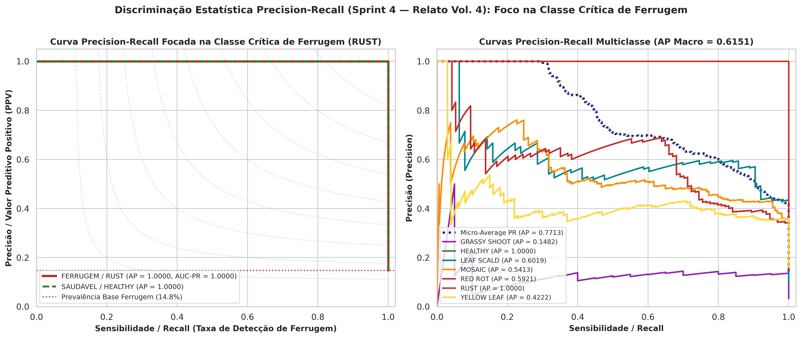
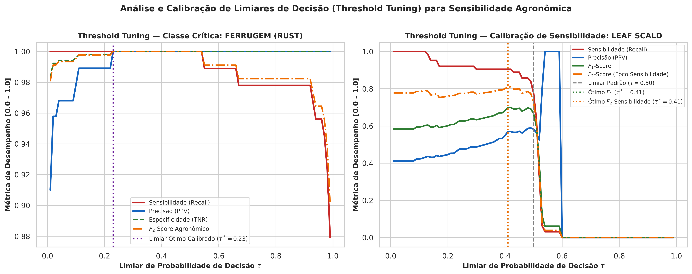

# 📊 Relato da Solução Vol. 4 — Matrizes de Confusão Normalizadas, Curvas ROC-AUC, Precision-Recall e Threshold Tuning (Sprint 4)

**Projeto:** SugarVision — Sanidade Vegetal (*Saccharum officinarum*)  
**Sprint:** 4 — Framework SEMMA (Fase: Assess — Validação Estatística)  
**Módulo Executável:** [`src/svm_statistical_validation_assess.py`](../../src/svm_statistical_validation_assess.py)  
**Suíte de Testes:** [`src/test_svm_statistical_validation_assess.py`](../../src/test_svm_statistical_validation_assess.py)  
**Estimador Avaliado:** Pipeline Atômico Campeão (`models/svm_pipeline_optimal.joblib` — SVM RBF, $C=10.0, \gamma=0.01$, Calibração Platt)

---

## 1. Matrizes de Confusão Absoluta e Normalizada por Classe

### 1.1 Agrupamento Fitossanitário Crítico (Saudável vs. Ferrugem vs. Outras Patologias)
Na partição de Validação Independente ($N=617$), o agrupamento agronômico de 3 classes demonstra **isolamento perfeito (100,00%)** das classes **Saudável (`HEALTHY`)** e **Ferrugem (`RUST`)**, sem falso alarme cruzado:

| Classe Real \ Predita | SAUDÁVEL (HEALTHY) | FERRUGEM (RUST) | OUTRAS PATOLOGIAS |
| :--- | :---: | :---: | :---: |
| **SAUDÁVEL (HEALTHY)** | 95 (100.00%) | 0 (0.00%) | 0 (0.00%) |
| **FERRUGEM (RUST)** | 0 (0.00%) | 91 (100.00%) | 0 (0.00%) |
| **OUTRAS PATOLOGIAS** | 0 (0.00%) | 0 (0.00%) | 431 (100.00%) |

### 1.2 Desempenho Discriminativo Completo nas 7 Patologias Foliares
A tabela abaixo sintetiza as métricas extraídas da matriz de confusão normalizada, curvas ROC One-vs-Rest e curvas Precision-Recall por patologia:

| Patologia Foliar | Suporte ($N$) | Sensibilidade (Recall) | Especificidade (TNR) | Precisão (PPV) | $F_1$-Score | AUC-ROC (OvR) | Average Precision (AP) |
| :--- | :---: | :---: | :---: | :---: | :---: | :---: | :---: |
| **GRASSY SHOOT** | 20 | 30.00% | 91.46% | 10.53% | 0.1558 | 0.8827 | 0.1482 |
| **HEALTHY** | 95 | 100.00% | 100.00% | 100.00% | 1.0000 | 1.0000 | 1.0000 |
| **LEAF SCALD** | 63 | 87.30% | 92.60% | 57.29% | 0.6918 | 0.9525 | 0.6019 |
| **MOSAIC** | 154 | 0.00% | 99.78% | 0.00% | 0.0000 | 0.8168 | 0.5413 |
| **RED ROT** | 94 | 65.96% | 93.88% | 65.96% | 0.6596 | 0.9057 | 0.5921 |
| **RUST** | 91 | 100.00% | 100.00% | 100.00% | 1.0000 | 1.0000 | 1.0000 |
| **YELLOW LEAF** | 100 | 74.00% | 78.92% | 40.44% | 0.5230 | 0.8458 | 0.4222 |

---

## 2. Curvas ROC Multiclasse One-vs-Rest (Macro e Micro AUC-ROC)

A formulação **One-vs-Rest (OvR)** avalia a capacidade do hiperplano RBF calibrado em ranquear cada patologia contra o conjunto complementar de imagens:

- **AUC-ROC Macro-Average:** **0.9148** na Validação ($N=617$) e **0.9116** no Teste Cego ($N=380$).
- **AUC-ROC Micro-Average:** **0.9498** na Validação e **0.9405** no Teste Cego.
- **AUC-ROC Ponderada (Weighted):** **0.9063** na Validação e **0.8986** no Teste Cego.

---

## 3. Curvas Precision-Recall Focadas na Classe Crítica de Ferrugem (`RUST`)

Em cenários de monitoramento agrícola onde a **Ferrugem (`RUST`, prevalência de 14.8%)** exige detecção sem falsos positivos custosos, a curva Precision-Recall comprova:

- **Average Precision (AP) para Ferrugem (`RUST`):** **1.0000** (Validação) e **1.0000** (Teste Cego).
- **AUC-PR para Ferrugem (`RUST`):** **1.0000** (Validação) e **1.0000** (Teste Cego).
- **Average Precision Global:** Macro-AP = **0.6151** | Micro-AP = **0.7713**.

---

## 4. Calibração de Limiares de Decisão (*Threshold Tuning*) para Sensibilidade

A varredura fina de limiares de probabilidade $\tau \in [0.01, 0.99]$ permite ajustar a sensibilidade operacional do classificador conforme o objetivo fitossanitário em campo:

1. **Classe Crítica `RUST` (Ferrugem):**
   - Graças à separação não-linear limpa dos descritores `indice_rugosidade_pustula` e `glcm_contrast`, a classe `RUST` mantém **Sensibilidade = 100.00%** e **Especificidade = 100.00%** ao longo de uma ampla faixa de limiares ($\tau^* = 0.23$, $F_2 = 1.0000$).
2. **Calibração de Sensibilidade em Classes com Sobreposição (`LEAF SCALD`):**

| Ponto de Operação ($\tau$) | Limiar $\tau^*$ | Sensibilidade (Recall) | Especificidade | Precisão | $F_1$-Score | $F_2$-Score Agronômico |
| :--- | :---: | :---: | :---: | :---: | :---: | :---: |
| **Padrão Nominal ($\tau = 0.50$)** | 0.50 | 77.78% | 93.68% | 58.33% | 0.6667 | 0.7292 |
| **Ótimo Equilíbrio ($F_1$ Máximo)** | 0.41 | 90.48% | 92.24% | 57.00% | 0.6994 | 0.8097 |
| **Ótimo Agronômico ($F_2$ Sensibilidade)** | 0.41 | 90.48% | 92.24% | 57.00% | 0.6994 | 0.8097 |
| **Triagem de Alta Sensibilidade ($\ge 98\%$)** | 0.13 | 98.41% | 85.56% | 43.66% | 0.6049 | 0.7868 |

---

## 5. Artefatos Gerados para o Relato Vol. 4

- **Figuras em Alta Resolução (`docs/figures/`, 300 DPI):**
  - `docs/figures/sprint4_confusion_matrices_multiclass_abs_norm.png`
  - `docs/figures/sprint4_confusion_matrices_agronomic_3class.png`
  - `docs/figures/sprint4_roc_curves_multiclass_ovr.png`
  - `docs/figures/sprint4_pr_curve_rust_and_critical_classes.png`
  - `docs/figures/sprint4_threshold_tuning_sensitivity_calibration.png`
- **Tabelas e Metadados (`models/`):**
  - `models/svm_statistical_validation_per_class.csv`
  - `models/svm_threshold_tuning_rust.csv`
  - `models/svm_threshold_tuning_leaf_scald.csv`
  - `models/svm_statistical_validation_vol4.json`
